# Bosch PRD — Incident Zero: AI On-Call Engineer

**Product:** Evidence-driven, human-approved AI incident response agent for the OpenTelemetry Demo (“Astronomy Shop”)  
**Status:** Hackathon implementation PRD · **Scope:** High-level features and high-level design only  
**Reference:** [`ProblemStatement.md`](./ProblemStatement.md) — source-faithful requirements and rules from the seven Bosch screenshots

## 1. Product vision

Build a **local-first AI On-Call Engineer** that receives an incident alert, investigates a failing cloud-native microservices application using live observability tools, produces a **defensible, evidence-linked root-cause diagnosis**, recommends a **preapproved category of remediation**, **waits for explicit human authorisation**, applies the change **only through the designated Action API**, verifies recovery, and produces a machine-scorable and human-readable incident report.

The agent must also know **when not to act**. Insufficient, ambiguous, or contradictory evidence should lead to a useful escalation, never a fabricated cause or an unsafe automated change.

### Product success definition

A reviewer can reproduce one full, safe incident lifecycle on the local OpenTelemetry Demo:

**Alert → Dynamic tool investigation → Evidence-backed diagnosis + confidence → Allowed remediation proposal → Explicit human approval → Action API execution → Recovery check / rollback or escalation → JSON + readable report.**

The solution must generalise to **unseen and combined incidents** rather than rely on known feature-flag settings, prepared answers, or exact incident identifiers.

## 2. Users, environment and product boundaries

- **Primary user:** On-call human / judge reviewing the agent's findings and deciding whether a proposed remediation may run.
- **Secondary user:** Team member operating the local demo, injecting permitted practice incidents and reviewing investigation/report results.
- **Target:** OpenTelemetry Demo running locally with Docker Compose, or organisers' **offline telemetry bundles** for investigation-only scenarios.
- **Inputs:** Alert events, traces, metrics, logs, container health, and deployment history where available.
- **Outputs:** Diagnosis with real evidence and confidence, proposed allowlisted action, human decision record, execution/verification status, incident report in the **organisers' exact JSON schema**, plus readable explanation.
- **LLM/framework:** Provider and implementation technology are flexible; no model/framework is mandated by the screenshots. Use the supplied template, JSON schema and Action API contract when available.
- **Non-negotiable limits:** No modification of demo source/configuration, `faultctl`, hidden-test materials or scoring harness; no feature-flag-setting reads for diagnosis; no agent-initiated state changes outside the Action API; no production/remote systems.

## 3. High-level functional requirements

Priority indicates delivery order, not extra scoring rules. **P0** is the minimum viable end-to-end agent; **P1** improves reliability and evaluation readiness; **P2** contains only the organisers' optional stretch goals.

| ID | Feature | Priority | What the product must do | Done when… |
|---|---|---|---|---|
| **F01** | **Alert detection and incident intake** | P0 | Detect error-rate or latency alerts from demo metrics; create an incident context and start investigation without manually typing the root cause. | An alert triggers one traceable investigation session. |
| **F02** | **Read-only observability tools** | P0 | Expose callable tools for **metrics, traces, logs, container health**, and **deployment history** where available; bind findings to specific services/time windows. | Agent can call tools and surface the returned source identifiers/values. |
| **F03** | **Dynamic investigation agent** | P0 | Select the **next tool based on previous results**, iteratively narrow the suspect service and time range, correlate cross-service signals, and stop when enough evidence is gathered or limits are reached. | Investigation is more than one hard-coded lookup or a single huge telemetry prompt. |
| **F04** | **Evidence-based root-cause analysis** | P0 | Name the suspected failing component and likely cause; attach exact supporting metric values, log lines and/or trace IDs/spans; provide a confidence statement and alternative explanations when relevant. | Each substantive diagnosis claim maps to telemetry that can be inspected. |
| **F05** | **Uncertainty-aware escalation** | P0 | Decline action and escalate with the evidence gathered when confidence/evidence is inadequate, conflicting, or out of scope. | Uncertain cases yield an honest, useful report without an unsafe change. |
| **F06** | **Allowlisted runbook planning** | P0 | Suggest an appropriate action **only** from the Action API's permitted operations: service restart, feature-flag toggle, load-generator throttle, and Kubernetes-only scaling. Include the target, reason, expected impact, risk and verification criteria. | No arbitrary command, code patch or uncontrolled remediation is proposed for execution. |
| **F07** | **Human approval, dry-run and kill switch** | P0 | Display diagnosis and proposed action; require an explicit **approve/reject** decision before execution; allow read-only dry runs; support an immediately enforceable kill switch. | Rejection, cancellation, absence of approval and dry-run all produce **zero live changes**. |
| **F08** | **Controlled action execution and audit** | P0 | Invoke the designated **Action API only after approval**, record requested and actual action, timestamp, outcome and errors; never bypass its allowlist or audit logging. | Executed changes correspond to an approved plan and are auditable. |
| **F09** | **Recovery verification, rollback and escalation** | P0 | Re-check telemetry/health after action; compare with pre-action symptoms; mark recovered only with evidence; if not recovered, safely roll back where supported and/or escalate. | Success is based on post-action health, not merely a successful API response. |
| **F10** | **Incident reports and schema output** | P0 | Generate report with timeline, cause, linked evidence, confidence, approval, action, post-action verification and recurrence-prevention notes. Emit the **exact organiser JSON schema**, plus readable Markdown/text. | Output passes provided schema validation and is understandable without reading raw logs. |
| **F11** | **Practice testing and evaluation** | P1 | Run permitted practice incidents, reset between runs, validate outputs, measure diagnosis/safety/verification outcomes, and record **right/wrong/uncertain** cases and limitations. | Team can demonstrate observed results on at least three mentor-selected practice incidents by the Brain checkpoint. |
| **F12** | **Local reproducibility and demo UX** | P1 | Offer a clear CLI or lightweight local interface for incident state, findings, approval, kill switch, and report links; provide one-command or well-documented startup and clean test flow. | A mentor can follow the README to reproduce the demo on the team's laptop. |
| **F13** | **Live/offline investigation input** | P1 | Abstract read-only investigation access so recorded telemetry bundles can be used when the full demo cannot run. Offline runs must not pretend a live remediation succeeded. | Offline inputs produce diagnostic reports and honestly identify unavailable action/verification capability. |

### Optional stretch features — not required for MVP

| ID | Feature | High-level intent |
|---|---|---|
| **S01** | Incident memory | Reuse prior incident **reports** as retrieval context for recurring failures without replacing current telemetry-based diagnosis. |
| **S02** | Reviewer agent | Independent check that challenges the primary diagnosis before human review. |
| **S03** | Calibrated confidence | Compare confidence estimates with accuracy on practice incidents and report calibration quality. |
| **S04** | Chat-style approval | Replace/augment CLI confirmation with a local chat or dashboard approval experience. |
| **S05** | Prevention recommendations | Suggest code, configuration or alerting changes to prevent recurrence **as recommendations only**—do not directly alter demo code/config. |

## 4. High-level system design (HLD)

The diagram shows **logical components**, not prescribed files, processes, frameworks or API endpoints. Solid arrows indicate data/control flow; labels distinguish **read-only investigation** from **state-changing actions**.

```mermaid
flowchart TB
    subgraph LOCAL["Own laptop / local hackathon environment"]
      AL["Alert Source<br/>error rate / latency"] --> IN["Incident Intake & Context"]
      IN --> ORCH["Agent Orchestrator<br/>investigation state + tool selection"]
      subgraph OBS["Read-only investigation plane"]
        TOOLS["Observability Tool Gateway<br/>metrics / logs / traces / health / deployments"]
        TEL["Live OTel telemetry + local viewers"]
        OFF["Offline incident bundles<br/>optional input"]
        TEL --> TOOLS
        OFF --> TOOLS
      end

      EVID["Evidence & Correlation Store<br/>time windows, raw references, findings"]
      DIAG["LLM Diagnosis & Confidence<br/>root cause / uncertainties"]
      PLAN["Allowlisted Runbook Planner"]
      GATE["Human Approval Gate<br/>approve / reject / dry-run"]
      SAFE["Safety Controller<br/>allowlist / kill switch / approval check"]
      API["Designated Action API<br/>only write path"]
      VERIFY["Recovery Verifier<br/>compare health before / after"]
      REP["Report & JSON Schema Formatter"]
      AUD["Decision + Action Audit Trail"]
      HUMAN["Human Operator"]
      APP["OpenTelemetry Demo<br/>Astronomy Shop microservices"]
      OUT["Exact organiser JSON<br/>+ readable incident report"]
    end

    ORCH -->|"choose next read-only tool"| TOOLS
    TOOLS -->|"observed data"| EVID
    EVID --> DIAG
    DIAG -->|"more evidence required"| ORCH
    DIAG -->|"supported diagnosis"| PLAN
    DIAG -->|"uncertain / unsupported"| HUMAN
    PLAN --> GATE
    HUMAN -->|"explicit decision"| GATE
    GATE -->|"rejected / not approved"| REP
    GATE -->|"approved action"| SAFE
    HUMAN -->|"kill switch / stop"| SAFE
    SAFE -->|"authorised only"| API
    API -->|"allowed local change"| APP
    APP -->|"telemetry"| TEL
    API --> AUD
    SAFE --> AUD
    GATE --> AUD
    API --> VERIFY
    VERIFY -->|"re-read metrics, logs, health"| TOOLS
    VERIFY -->|"recovered / rollback / escalate"| REP
    EVID --> REP
    DIAG --> REP
    AUD --> REP
    REP --> OUT
```

### Component responsibilities

| Component | Purpose and key responsibility | Boundary / important design rule |
|---|---|---|
| **Alert source** | Surface a metric threshold breach (e.g., error rate or latency). | Detect symptoms, **not prelabelled causes**. |
| **Incident intake & context** | Create an incident ID, timestamps, alert metadata, affected service candidates, and investigation context. | Keep incidents and their observations separate. |
| **Agent orchestrator** | Manage the investigation state and repeatedly choose tools based on evidence gathered so far. | Bounded exploration; do not flood a single prompt with all telemetry. |
| **Observability tool gateway** | Offer structured, **read-only** calls for traces, metrics, logs, health and, if exposed, deployment history. | Never query `flagd` settings/UI/API to discover the answer. |
| **Live telemetry + viewers** | Source observability data from OpenTelemetry Demo and the collector/viewers. | Remain on the team's local environment. |
| **Offline incident bundles** | Optional alternative telemetry source when the live demo is not feasible. | Read-only evidence source; cannot establish live recovery. |
| **Evidence & correlation store** | Retain selected values, timestamps, IDs, short extracts and cross-service links for justification. | Preserve source provenance, rather than inventing plausible evidence. |
| **LLM diagnosis & confidence** | Synthesize observed symptoms into a likely component/cause and confidence/uncertainty. | Unsupported claims must not become facts; low confidence leads to escalation. |
| **Allowlisted runbook planner** | Match diagnosis to one supported Action API operation and specify target, rationale, risks and checks. | No arbitrary code execution, shell changes or mutation outside supplied API. |
| **Human approval gate** | Present evidence and plan; record an explicit approval or rejection; enable dry-run review. | No approval = no write; changed plans require fresh approval. |
| **Safety controller** | Independently enforce human approval, Action API allowlist, scope and kill-switch state. | Fail closed if approval, target or operation is invalid/missing. |
| **Action API** | Execute and log the authorised local changes. | **Sole modification boundary**; Kubernetes scaling only when Kubernetes is used. |
| **Recovery verifier** | Sample post-action telemetry and compare with baseline/alert state; distinguish recovery from partial/no recovery. | API success does **not** imply incident resolution; rollback only when safe/supported. |
| **Decision + action audit trail** | Track tool reads, diagnoses, approval responses, safety decisions, API calls and outcomes. | Supports explainability and human review; no destructive alteration of evidence. |
| **Report & schema formatter** | Convert investigation, decisions and outcomes into the provided JSON structure and a readable report. | Do not invent the organiser's JSON field names; load/use the provided schema. |
| **Human operator** | Approve, reject, cancel, inspect evidence and receive escalations. | Human retains final control over state-changing remediation. |

**Diagram note:** `faultctl` belongs to the **team's test/incident-injection harness**, not the agent's observation or action path. Keep the injector separate from the diagnostic agent. Approval, verifier, report and audit paths are shown logically; exact interfaces depend on the supplied starter kit.

## 5. Expected workflow and safety states

1. **Detected:** An alert launches an investigation with a service/time-window context.
2. **Investigating:** The orchestrator selects observability tools, accumulates real evidence and may loop for more data.
3. **Diagnosed or escalated:** The agent reports component, root cause, confidence and source references; if uncertain, it escalates and stops short of proposing an unsafe action.
4. **Proposed:** A remediation plan selects an **available Action API operation**, targeted service and recovery criteria.
5. **Awaiting approval:** Human can inspect evidence, run a read-only dry-run preview, approve, reject or activate kill switch. **No write before approval.**
6. **Executing:** Safety controller revalidates the authorised plan and kill-switch state immediately before every write, then invokes Action API.
7. **Verifying:** Fresh telemetry measures whether symptoms cleared. If not, invoke an appropriately authorised/safe recovery or rollback path if supported, otherwise escalate.
8. **Closed / escalated:** Output schema-conformant JSON and human-readable report; retain accurate success, failure or uncertainty status.

### Non-negotiable safety invariants

- Every **state-changing** action requires an explicit human **yes** and is sent **only through the Action API**. Denial, timeout, dry-run and missing approval do not execute.
- The agent is prohibited from inspecting feature-flag settings for diagnosis, even if toggling a flag is a valid **approved remedy** through Action API.
- The kill switch prevents any further state-changing calls and is demonstrable during a live test.
- Evidence citations/IDs must reference **observed** telemetry, not generated or fabricated logs.
- **No action** can be a successful safe outcome when the evidence is not adequate.
- Reports must distinguish **proposed**, **approved**, **attempted**, **executed**, **verified**, **failed**, **rolled back** and **escalated** states; never claim recovery without a health check.

## 6. Quality and acceptance criteria

| Quality area | High-level acceptance criterion |
|---|---|
| **Generalisability** | Diagnose from telemetry across different symptoms/services; avoid lookup by practice incident name, failure flags, or canned answer tables. |
| **Evidence quality** | Each root-cause claim includes specific telemetry references/values and relevant timestamps; unsupported conclusions explicitly labelled as hypotheses. |
| **Tool use** | Tool selection follows the findings of previous calls; tools do not read prohibited flag settings. |
| **Safety** | Approval gate, dry-run and kill switch work; no writes are possible via a bypass path. |
| **Action scope** | Only permitted runbook actions are exposed; Kubernetes-only scaling is unavailable without Kubernetes. |
| **Verification** | Run real post-action checks, with accurate recovery/rollback/escalation outcomes. |
| **Machine-readable output** | Validate each incident record against the **actual supplied** JSON schema. |
| **Testing** | Keep an evaluation note for practice incidents attempted, including correct, incorrect and escalated cases, with reasons. |
| **Repeatability** | A clean local setup can run the agent, trigger a practice incident, and produce the report using documented steps. |
| **Transparency** | Preserve failures, unresolved questions, errors and limits in the demo and submissions. |

## 7. Delivery order aligned to the checkpoint structure

| Stage | High-level deliverable | Features |
|---|---|---|
| **Setup / Checkpoint 0** | Local OpenTelemetry Demo or offline input available; agent can connect to telemetry sources; starter repository and LLM access working. | Environment foundation |
| **Eyes / Checkpoint 1** | Live alert/investigation run on a practice incident; working read-only tools and architecture overview. | F01–F03 |
| **Brain / Checkpoint 2** | Evidence-backed root cause and confidence using organisers' JSON schema; test on at least **three** practice incidents chosen by mentor. | F04–F05, F10, F11 |
| **Hands / Checkpoint 3** | Full loop with allowlisted plan, human approval, Action API execution, recovery check and audit. | F06–F09 |
| **Freeze / Hidden test** | Harden reproducibility, kill switch, reporting and schema validation; submit **all five** deliverables; run on unseen incidents. | F10–F13 and hardening |

### Required repository deliverables

1. **Source code** with README: setup, run commands, approval gate, kill switch and known limitations.
2. **One-page architecture overview** (this diagram can be condensed to a one-page diagram for submission).
3. **Incident reports** in organisers' JSON schema **and** readable form.
4. **Evaluation note** explaining practice incidents that succeeded/failed and why.
5. **Team form** listing responsibilities, models, tools, coding assistants and third-party libraries.

## 8. External contracts and unknowns

The **Action API is designated as the only modification interface**, but the screenshot starter-kit table lists its source as “Team”; check the starter pack to learn whether it is supplied, scaffolded, or implemented by the team. The screenshots **do not include** the concrete Action API endpoints, authentication model, approved runbook payloads, alert payload structure, telemetry query URLs, or **JSON schema fields**. Consequently, none are invented in this PRD; adapt adapters/validators to the actual starter template. The screenshots also leave **team size** (five vs three), **event duration** (one day vs two), **starting commit time** (09:15 vs 11:30 kickoff) and **freeze time** (16:30 vs Day 2 at 14:00) inconsistent. See §10 of `ProblemStatement.md` for the exact source contradictions. **Plan for the Day 2 14:00 cutoff until organisers confirm otherwise.**

## 9. Explicitly out of scope

Writing or editing demo application/configuration; allowing direct service changes via shell commands rather than Action API; reading `flagd` answers; using `faultctl` in agent reasoning; hardcoding practice failures; unsupervised remediation; affecting other teams, venue networking or actual production systems; adding a cloud deployment requirement; and treating any of the optional stretch capabilities as prerequisites for an MVP.

---

**Implementation philosophy:** **Reliable evidence → cautious decisions → enforceable human control → verified outcome**. A correct escalation with transparent findings is better than an unjustified, confidently wrong intervention.
