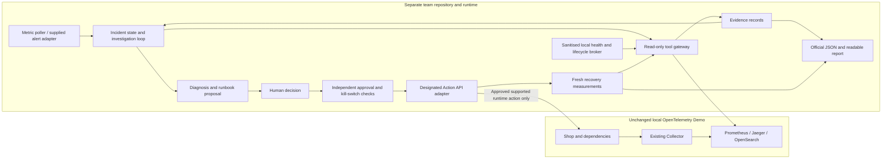

# Implementation Plan — Incident Zero: AI On-Call Engineer

**Inputs:** [ProblemStatement.md](./ProblemStatement.md) and [Bosch_PRD.md](./Bosch_PRD.md).

**Delivery target:** The two-day milestones in ProblemStatement §9, ending at the provisional **Day 2, 14:00 code freeze**.

**Implementation boundary:** Build a separate local incident-response application around the unchanged OpenTelemetry Demo. This document is a plan; it does not implement or claim to have tested that application.

## 1. Scope, constraints, and delivery decisions

Deliver the complete loop: **metric alert → adaptive investigation → evidence-backed diagnosis → allowlisted proposal → explicit approval → Action API execution → recovery verification → incident report**. A well-supported escalation is a valid result when evidence or safe remediation is unavailable.

The existing codebase must remain unchanged throughout implementation:

- Keep every existing application, configuration, dependency manifest, lockfile, generated file, test, and workflow unchanged. This includes `src/`, `pb/`, `telemetry-schema/`, `compose*.yaml`, `.env`, `.env.override`, `otel-config.yml`, `Makefile`, and the existing README.
- Put challenge implementation and submission artifacts in the separate team/template repository. Do not add an incident service to the demo's Compose definitions, repurpose its shopping agent, install dependencies into its service environments, or regenerate its protobufs.
- Use the checked-in Compose layers as supplied. Keep incident-agent configuration, credentials, evidence, reports, virtual environment, and optional container definition in the separate team repository or its private runtime directory.
- Runtime remediation is allowed only through the designated Action API after human approval. Runtime permission does **not** permit rewriting source-controlled demo configuration. Validate this distinction for each action and practice injector before enabling it.
- Do not modify `faultctl`, hidden incidents, or the scoring harness. Keep the injector and its answer labels outside the agent's input and tools.
- Diagnose from telemetry and sanitised container observations. Do not read feature-flag settings, files, UI, resolution APIs, or injected-fault descriptions to discover the cause.
- Keep the environment on the team's laptop. LLM access uses the event-authorised provider/key or a local model; no cloud deployment is needed.

The implementation choices below are proposals, not additional organiser requirements. Concrete scoring fields, Action API routes, alert payloads, and starter-kit commands must come from the actual supplied contracts.

### 1.1 Resolve the source contradictions at kickoff

| Item | Planning assumption until confirmed | Required resolution |
| --- | --- | --- |
| One day versus two days | Follow the complete Day 1/Day 2 milestone table. | Record the event's authoritative schedule. |
| Freeze at 16:30 versus 14:00 | Finish and submit by **Day 2, 14:00**. | Obtain the actual freeze and submission mechanism. |
| Five members versus three | Assign responsibilities by role; every confirmed member should contribute and understand the solution. | Confirm team size and required commit participation. |
| Coding at 09:15 versus kickoff at 11:30 | Prepare the environment in advance; begin challenge coding/committing only at the authorised start. | Confirm when implementation and commits may begin. |
| Starter components labelled “Team” | Do not assume Action API, `faultctl`, bundles, schema, or template are ready-made. | Establish what is supplied, scaffolded, or team-owned. |
| Flag-based practice versus unchanged configuration | Enable only injection/remediation mechanisms that preserve existing files. | Confirm a compliant runtime mechanism; otherwise use compatible infrastructure practice or offline investigation and disclose the gap. |

These are kickoff dependencies, not reasons to delay building read-only adapters or the internal incident model after coding is authorised. Missing Action API access blocks live Hands acceptance; a missing official schema blocks scoring-compliance acceptance. Neither may be represented as complete using a mock.

## 2. Repository findings and implementation consequences

The review covered the repository layout, all service directories, service documentation and entry points relevant to dependencies, Compose layers, Dockerfiles/manifests, protobuf contracts, telemetry registry, collector/backend configuration, dashboards, tests, build tooling, and CI definitions. Generated protocol files, lockfiles, and static assets are existing artifacts to preserve, not integration surfaces to edit. Findings below are grounded in this checkout, whose reviewed HEAD is `ad06a6f9`; they are not assumptions about another demo release.

### 2.1 Deployment and observability layers

| Existing surface | Finding | Consequence for this plan |
| --- | --- | --- |
| [compose.yaml](./compose.yaml) | Core services, load generation, flagd/UI, PostgreSQL, Valkey, and Collector. Base pipelines export to debug; traces also feed span metrics. | Base Compose alone is insufficient for the planned query adapters. Include the existing observability layer for live investigation. |
| [compose.full.yaml](./compose.full.yaml) | Adds Kafka, accounting, fraud detection, checkout Kafka configuration, and collector Kafka metrics. | Use for full coverage when resources permit. Do not assume these services exist in core mode. |
| [compose.observability.yaml](./compose.observability.yaml) | Adds Jaeger, Prometheus, OpenSearch, Grafana, OpAMP, and collector exporters. | Reuse these backends without changing collector or Grafana configuration. |
| [Makefile](./Makefile) | `start` selects full + observability + extras; `start-minimal` selects core + observability + extras. | “Minimal” here still includes the flag UI and observability stack. The brief's approximately 3 GB description is not a measured guarantee for this checkout. |
| `compose.extras.yaml` and collector extras | Extension stubs invite customisation. | Leave them unchanged despite that invitation; the user's preservation requirement controls. |
| `compose.agent.yaml`, `src/agent`, `src/mcp`, `src/chatbot` | Existing AI functionality operates the shop. The agent reads flags and exposes cart/checkout tools; it is not an incident-response starter. | Do not reuse its tool registry or flag provider. Omit this layer for the MVP, unless the organisers explicitly include it as a workload under test. |
| `compose.profiling.yaml` | Optional privileged eBPF profiler and Firepit. | No profiling dependency for MVP. Do not enable it to solve a required checkpoint. |
| `src/otel-collector/otelcol-config*.yml` | OTLP plus container, host, frontend health, Valkey, PostgreSQL, and ad metrics; backend exporters added by layer. Configuration arrays replace earlier arrays. | Discover signals from the effective existing deployment; never fix a missing signal by editing or layering replacement collector configuration. |
| `src/prometheus/prometheus-config.yaml` | OTLP ingest, promoted resource labels including `service.name`, 60-second configured scrape interval, out-of-order allowance. | Learn actual exported names, labels, units, sample cadence, and freshness. Do not treat every signal as scraped or newly available every second. |
| `src/jaeger/config.yml` | Jaeger uses in-memory trace storage, a bounded trace count, and query base path `/jaeger/ui`. | Capture evidence promptly; reports must survive backend eviction. Preserve the query base path. |
| OpenSearch exporter and Grafana datasource | Log indices use `otel-logs-*`; datasource identifies `observedTimestamp`, `body`, and severity fields. | Discover mappings, normalise event/observed times, and retain document IDs and exact extracts. |
| `src/frontend-proxy/envoy.tmpl.yaml` | Existing paths serve shop, Jaeger, Grafana, loadgen, flags, telemetry docs, and other UIs. | Agent uses explicit permitted backend paths; proxy reachability does not authorise arbitrary URLs, flag reads, or admin mutations. |

The observability Compose layer also loads the collector's full configuration even without the full workload layer. Its Kafka receiver can therefore fail to scrape in core mode; inspect actual errors and classify absent Kafka separately from a failure in a deployed service. The base collector already configures PostgreSQL monitoring because PostgreSQL is a core dependency in this checkout.

### 2.2 Application dependencies to incorporate into diagnosis

| Service group | Existing dependencies and interfaces | Investigation implication |
| --- | --- | --- |
| `frontend-proxy` → `frontend` | Envoy entry point; Next.js frontend/API; browser telemetry appears as `frontend-web`. | A frontend error may originate downstream. Separate browser, proxy, and server identities. |
| Frontend fan-out | Ad, cart, checkout, currency, product catalog, recommendation, shipping; image-provider serves assets. | Follow failing/slow child spans and the affected operation rather than naming the entry point as root cause. |
| `checkout` | Cart, currency, payment, product catalog via gRPC; shipping and email via HTTP in current code; Kafka only in full mode. | HTTP and gRPC status semantics differ. `pb/demo.proto` alone does not describe every current transport. |
| `cart` → `valkey-cart` | .NET cart storage uses Valkey/Redis-compatible client instrumentation. | Correlate cart failures with cache connectivity and container health before recommending cart restart. |
| `product-catalog` → `astronomy-db` | Go catalog queries PostgreSQL; database and SQL telemetry are already configured. | Product-specific failures and database-wide failures require different evidence. Core mode still needs PostgreSQL. |
| `recommendation` → `product-catalog` | Java/Spring Boot service with runtime and request telemetry. | Correlate upstream catalog latency, heap growth, GC pressure, and container memory over time; one high memory sample does not prove a leak. |
| `ad` | Java service; runtime telemetry and an existing Prometheus scrape endpoint. | Use CPU/GC/latency correlation; running/TCP-healthy does not imply usable responses. |
| `payment`, `currency` | Node.js payment and C++ currency on checkout paths. | Use error spans and request-level failures; a successful homepage request does not verify checkout recovery. |
| `shipping` → `quote`, plus `email` | Rust HTTP shipping calls PHP quote; Ruby email participates in checkout. | Follow both downstream paths; low-volume services may need more observation time. |
| `checkout` → Kafka → `accounting`, `fraud-detection` | Asynchronous order flow; accounting also writes PostgreSQL. | Kafka producer and consumer traces may not share parent-child links. Use available messaging identifiers/time correlation and state uncertainty. |
| `load-generator` | Locust HTTP traffic and optional browser users; browser processes increase memory use. | Track request volume and traffic mix. Throttling can hide a failure unless verification requires sufficient continuing traffic. |
| Supporting components | Collector, Jaeger, Prometheus, OpenSearch, Grafana, OpAMP, telemetry-docs, flagd/UI. | An evidence-backend outage must not be misreported as application recovery or repaired through an improvised control-plane change. |
| Optional clients/services | React Native sample; shopping `agent`, MCP, chatbot. | Not required to implement the incident agent. If present during evaluation, treat their signals as workload observations without importing their capabilities. |

Use this topology as context, not an answer table. The orchestrator must inspect the current incident's telemetry, allow multiple failing components, and distinguish a root dependency failure from cascading symptoms.

### 2.3 Existing contracts, tests, and missing challenge artifacts

- [test/telemetry/conftest.py](./test/telemetry/conftest.py) demonstrates this checkout's Jaeger v3 query shape, Prometheus API use, OpenSearch querying, and independent backend warmup. Use it as a read-only reference.
- [test/telemetry/services.py](./test/telemetry/services.py) defines expected service/signal coverage and trace edges, including missing browser/image-provider logs and unlinked asynchronous edges. A missing unsupported signal is not an incident.
- [telemetry-schema](./telemetry-schema/README.md) defines existing custom attributes and metrics. Use these definitions and upstream semantics as query vocabulary; do not introduce demo instrumentation or registry changes.
- Existing dashboards contain candidate span metrics such as `traces_span_metrics_calls_total` and `traces_span_metrics_duration_milliseconds_bucket`. Validate their availability and labels at setup rather than assuming every image emits them identically.
- No hackathon `faultctl`, designated remediation Action API, incident scoring JSON schema, offline practice bundles, or challenge template was found in the repository review. The feature-flag RPCs in `pb/demo.proto` and the shopping MCP server are not substitutes for the designated Action API.
- No local Kubernetes deployment package is needed for the Compose MVP. Scaling remains disabled unless an authorised Kubernetes environment and matching Action API capability are explicitly supplied.
- [CONTRIBUTING.md](./CONTRIBUTING.md), [AGENTS.md](./AGENTS.md), and CI describe contribution checks and telemetry conventions. Challenge code stays in the team repository; this work does not open an upstream issue/PR or post generated text. Any later upstream contribution follows its human-text approval and AI-assistance disclosure requirements.

## 3. Separate application architecture

### 3.1 Processes and trust boundaries

Use a small Python application with explicit state transitions and a typed tool-calling loop. A specialised agent framework is optional; it is not necessary for adaptive investigation. Keep the MVP CLI-based so a dashboard does not compete with safety and diagnosis work.



The diagram's health broker is a trusted adapter, not a generic Docker tool exposed to the model. The agent receives neither a Docker socket nor a mounted demo checkout. A socket mounted with `:ro` does not itself restrict Docker API operations. If host inspection is needed, expose a narrow local broker with fixed read operations and sanitised output; keep any privileged backend implementation outside the model process.

If containerisation helps isolation, a **separate** team-owned Compose project may attach its own read gateway to the existing `opentelemetry-demo` network as an external network. It must not redefine demo services, publish replacement demo ports, mount demo source, or join the demo project as an override. A host-run process using discovered published backend ports is the simplest first implementation.

### 3.2 Proposed team repository layout

This is a future layout in the supplied team/template repository, not directories to create in the demo checkout. Adapt names to the supplied template.

```text
team-incident-zero/
  README.md
  pyproject.toml                 # Separate dependency declarations
  requirements.lock            # Resolved versions for selected Python runtime
  .gitignore                    # Team secrets/runtime files only
  config/
    example.toml                # Endpoint references and bounded runtime options
    runbooks.json               # Approved operation catalog; no incident answers
  contracts/
    incident.schema.json        # Exact supplied scoring schema, unchanged
  incident_zero/
    cli.py                      # Start, review, approve/reject, kill, report
    intake.py                   # Alerts, deduplication, incident creation
    orchestrator.py              # Adaptive read-only tool loop
    models.py                   # Internal records and state transitions
    evidence.py                 # Evidence IDs, provenance, stored responses
    llm.py                      # Provider-neutral tool-call adapter
    tools/                      # Metrics, traces, logs, health, history, offline
    diagnosis.py                # Structured findings and evidence checks
    planning.py                 # Runbook selection and immutable plan
    safety.py                   # Gate, stop latch, approval binding
    actions.py                  # Designated Action API client only
    verification.py             # Recovery and rollback decisions
    reporting.py                # Official schema mapping plus Markdown
    storage.py                  # Durable incident/event records
  tests/                        # Adapter, safety, lifecycle, and schema checks
  docs/architecture.md           # One-page submission overview
  docs/evaluation.md
  docs/team-form.md
  reports/                      # Sanitised JSON and readable practice reports
```

Private runtime storage contains backend snapshots, SQLite state, local settings, and secrets. Submission reports reference sanitised evidence retained with the submission where permitted. Supplied fixtures/bundles remain immutable; model cassettes are development aids and must never masquerade as live hidden-test results.

### 3.3 Internal records and durable state

Use internal types independently of the official schema, then implement an explicit output mapper. These are proposed internal fields, **not invented organiser JSON fields**:

| Record | Required internal content |
| --- | --- |
| Incident | UUID, source alert fingerprint, UTC onset/receipt times, affected operation/services, mode, state, capability snapshot, budgets. |
| Tool observation | Tool and validated arguments, requested time window, request/response time, source, structured result, errors, freshness, truncation. |
| Evidence | Stable evidence ID, observation ID, service/operation, event time, exact metric samples or log extract or trace/span IDs, units, raw-response reference/hash. |
| Diagnosis | Supported claims with evidence IDs, suspected component(s), cause versus hypothesis, alternatives, confidence and limitations. |
| Plan | Version and digest, incident/target, allowlisted operation and exact parameters, reason, risk, expiry, preconditions, expected effect, verification and rollback proposal. |
| Approval | Human identity/session, explicit decision, decision time, plan digest, expiry, scope including any separately specified rollback. |
| Action attempt | Operation/idempotency reference, approval reference, start/end times, requested versus actual result, API audit ID, confirmed or unknown outcome. |
| Verification | Baseline and fresh queries, post-action windows, traffic coverage, health values, pass/fail/inconclusive, rollback/escalation decision. |

Persist events transactionally before executing changes. Use SQLite for states/approvals/action attempts and append-only JSONL or immutable files for observations and sanitised audit exports. Do not treat a local audit file as tamper-proof; its purpose is traceability and consistency. Record timestamps in UTC with original units; display event-local time when useful.

The controlled state sequence is `detected → investigating → diagnosed → proposed → awaiting_approval → executing → verifying → recovered/closed`. Side outcomes include `escalated`, `rejected`, `cancelled`, `expired`, `execution_unknown`, and `unresolved`. Persisted state must distinguish attempted/executed/verified actions. Restarting the application never restores permission to execute a pending plan automatically.

### 3.4 Dependency plan

| Dependency | Purpose | When needed / boundary |
| --- | --- | --- |
| Git, Docker Engine/Desktop with Linux containers, Compose v2 | Existing demo and separate team source | Setup. Use organiser-supported versions and the checked-in image references. |
| Python 3.11 | Proposed independent agent runtime, matching the prep brief | Setup. Validate selected libraries on it; existing demo Python images/manifests need not match and must not be changed. |
| `httpx` | Bounded async HTTP clients for telemetry, supplied API, and model transport if appropriate | Eyes onward. Separate telemetry, model, and action clients with different endpoint policies and credentials. |
| `pydantic` | Validate internal records, tool inputs, structured model output | Eyes/Brain. This does not replace official JSON Schema validation. |
| `jsonschema` | Validate exact organiser report schema | Brain onward, after schema receipt. Match its declared draft and supplied references. |
| Python standard library: `argparse`, `asyncio`, `sqlite3`, `json`, `hashlib`, `tomllib`, `pathlib` | CLI, loop, storage, configuration, IDs/digests | MVP. Avoid unnecessary infrastructure dependencies. |
| One event-approved model SDK, only if needed | Native tool-calling transport and token accounting | Eyes/Brain. Select based on supplied provider; no particular paid model or framework is required. |
| `pytest`, `pytest-asyncio`, HTTP request mocking such as `respx` | Adapter, lifecycle, approval, and failure-path verification | During implementation. Fixtures stay in team tests. |
| Docker client/SDK behind restricted health broker | Selected container state and lifecycle facts only | Eyes when an organiser-provided health API is absent and inspection is allowed. No generic inspection, exec, or mutation tool. |
| Supplied Action API, `faultctl`, practice set/bundles, scoring schema/template | Authorised remediation, practice, machine scoring | External contracts. Establish ownership and availability at kickoff. |

Resolve and pin compatible versions in the **team** environment once the starter and provider are known. Check the chosen Python runtime, schema draft, model tool-call support, and Windows paths; record versions in the team form. Never copy the demo's entire agent dependency set or alter its locks. Existing polyglot service builds remain inside their supplied images; installing Java, .NET, Go, Rust, PHP, Ruby, Elixir, Node development dependencies, or mobile tooling is not a prerequisite for this integration.

Use the existing backend REST APIs initially; dedicated Prometheus, OpenSearch, Jaeger, LangGraph, vector database, UI framework, Kubernetes, and new observability exporter dependencies are unnecessary for MVP. Add a dependency only if a concrete supplied contract requires it.

## 4. Milestone map and critical path

Times below reproduce the milestone schedule from ProblemStatement §9; no calendar event date is inferred.

| Milestone | Time | Main output | Depends on |
| --- | --- | --- | --- |
| M0 Kickoff | Day 1, 11:30–12:00 | Confirmed contracts, scope, roles, event rules | Organiser briefing |
| M1 Setup / Checkpoint 0 | 12:00–13:00; check 13:00 | Live demo/load, compliant inject/reset, model access, team repository | M0 and environment |
| M2 The agent can see / Eyes | 13:00–15:30; check 15:30 | Adaptive tools, incident symptoms, one-page architecture | M1 and backend access |
| M3 The agent can diagnose / Brain | 15:30–18:30; check 18:30 | Evidence-backed diagnosis, confidence, exact JSON, three mentor-selected cases | M2 and official schema |
| M4 Day 1 Wrap Up | 18:45 | Saved state, reports, test results, Day 2 blockers | M3 |
| M5 Day 2 Alignment | Day 2, 09:00–09:30 | Revalidated environment, prioritised feedback | M4 |
| M6 The agent can act safely / Hands | 09:30–12:00; check 12:00 | Full approved action/recovery loop, kill switch, audit/report | M3, M5, actual Action API |
| M7 Harden, document & prep | 12:00–13:30 | Clean reproducibility, safety regression, all deliverables | M6 |
| M8 Final verification / freeze | 13:30–14:00; freeze 14:00 | Final commit/submission and validation record | M7 |
| M9 Hidden test & mentor review | 14:00–15:30 | Frozen-code unseen-incident runs | M8 |
| M10 Evaluation & elimination | 15:30–16:30 | Honest results and qualification review | M9 |
| M11 Finalist demos / interviews | 16:30–18:45 | Five-minute live demo, three-minute Q&A, individual explanations | M10 |

Critical path: **contracts/environment → telemetry ingestion and adapters → evidence and diagnosis → proposal/approval/API → verification/report → reproducibility/freeze**. Build the report skeleton and audit storage during Eyes, not at the end of Hands. Start the Action API contract review during Setup even though live execution is delivered on Day 2.

Assign three core responsibility areas: observability/intake; investigation/evidence/reporting; safety/actions/verification. These are human team roles, not a requirement to build multiple AI agents. If the team has five members, allocate the remaining capacity to evaluation/reproducibility and operator UX/documentation. Everyone contributes in the separate team repository and can explain the safety path.

## 5. M0 — Kickoff: establish contracts and compliance

**Time:** Day 1, 11:30–12:00. **Purpose:** Remove integration ambiguity before coding against guessed interfaces.

1. Obtain the starter/template repository, official incident output schema and examples, practice incident instructions, `faultctl` usage, approved Action API/runbook specification, alert source details, offline bundle format, and submission instructions.
2. Record each contract's version/hash, owner, location, and availability in the team repository's integration checklist. Keep organiser-owned artifacts unchanged. Confirm whether the Action API and injector are supplied or must be implemented by the team.
3. For the Action API, establish operation names, target IDs, parameter bounds, authentication, approval expectations, audit/result format, sync versus async completion, idempotency, status lookup, dry-run semantics, rollback support, and cancellation. Internal adapter names in this plan must map to these real operations.
4. Confirm what read-only container information is permitted and whether deployment/lifecycle history exists. Do not assume Kubernetes events, a deployment feed, or access to unrestricted Docker metadata.
5. Check flag actions and `faultctl` for file writes. `flagd` and the flag UI mount `src/flagd`; a “runtime toggle” can change a repository file through that mount. Do not enable that path under the preservation constraint. Select an organiser-supported mechanism that preserves files, or leave the operation unavailable and choose a compliant infrastructure case for live Hands.
6. Record resolutions or pending answers for §1.1. Confirm the LLM data/spend policy and team responsibility areas. Do not send credentials, hidden incident definitions, or flag configuration to the model.
7. If the team must create the Action API, define a separate trusted local service to the organiser-approved contract, without altering demo files. It must own its privileged runtime adapter, fixed operation allowlist, target restrictions, audit trail, approval checks, and stop mechanism. Begin with a compliant restart operation; do not invent broad shell endpoints or use the flag UI as a shortcut. If no approved contract/mechanism is available, continue read-only work and raise the Hands dependency to the mentor.

**Exit evidence:** A short contract/dependency checklist, named owners, agreed starter location, authoritative schedule decisions, and a list of capabilities explicitly enabled or unavailable. No guessed API routes or scoring fields become implementation commitments.

## 6. M1 — Setup and Checkpoint 0

**Time:** Day 1, 12:00–13:00; checkpoint at 13:00. **PRD coverage:** Environment foundation, F12/F13 foundations.

### 6.1 Establish an unchanged, runnable demo

1. Record demo commit ID, initial Git status, selected Compose layer list, image identities, and a checksum inventory of existing files in private team runtime storage. Preserve pre-existing local/untracked work. Check checksums again after practice reset and before submission; Git alone will not catch edits to an ignored local override.
2. Verify Docker/Compose, Linux container support, available memory/disk, and existing image availability. The brief quotes about 6 GB RAM/14 GB disk and a comfortable 16 GB laptop; measure this checkout's real consumption, including backends, browser load users, model, and agent overhead.
3. Use **full + observability** if resources allow; use **core + observability** for reduced service coverage. Offline bundles are the fallback for investigation on constrained hardware. Do not remove services, edit memory limits, change image tags, or disable browser traffic in existing demo configuration to fit a memory target.
4. Start the selected existing layers as the human environment operator. These setup commands are not agent tools or remediation commands. For example, from the demo root, the existing default layer set can be started without changing files:

   ```powershell
   docker compose --env-file .env --env-file .env.override -f compose.yaml -f compose.full.yaml -f compose.observability.yaml -f compose.extras.yaml up -d --no-build
   ```

   For core + observability, omit only `-f compose.full.yaml`. Pull the same configured images beforehand if needed; do not rebuild demo services or substitute an unverified release. Keep the selected Compose project consistent for startup, port discovery, and operator inspection.

5. Verify shop/load generator and backend readiness separately. Collect at least one current query result from metrics, traces, and logs; a container's running state is insufficient. Wait for actual ingestion rather than assuming a fixed short startup sleep.
6. Discover host ports with the selected Compose context. Prometheus has an explicit host mapping in this checkout; Jaeger and OpenSearch use container-port-only declarations that can receive dynamic host ports. Do not assume `localhost:16686` or `localhost:9200` is valid. Alternatively use the permitted in-network gateway with `prometheus:9090`, `jaeger:16686`, and `opensearch:9200`.
7. Investigate platform issues as environment blockers. The collector source mentions a Docker Desktop/WSL memory-limiter workaround involving config edits; that is not available under this task's constraint. Use an organiser-supported unchanged environment or offline mode rather than applying that patch.

### 6.2 Bootstrap the separate incident application

1. Fork/initialise the required team repository after the authorised start. Create its independent Python environment and dependency lock; check a minimal model request with the supplied spend limit.
2. Store endpoint settings and credentials privately in the team environment. Use distinct names, such as an incident-agent provider setting, instead of relying on the demo shopping agent's environment or cassette mechanism.
3. Define capability discovery results: source availability, service scope, supported queries, live/offline mode, model readiness, official schema readiness, Action API readiness, and allowed operations. Store only sanitised values in reports.
4. Introduce incident/state/evidence models and durable storage. Add an initially **disabled** execution capability, a stop latch, and CLI placeholders for investigation/reporting; live actions remain impossible on Day 1.
5. As the human test operator, inject and reset one permitted practice incident through the actual `faultctl` instructions, after confirming file preservation. Verify symptoms appeared and fresh healthy telemetry returned after reset. Keep commands, fault names, and injector output out of agent context.
6. If the live environment fails, load one supplied offline bundle through a read-only adapter and preserve its timestamps. Record the blocked live acceptance criteria instead of claiming that offline mode satisfies live Setup or Hands.
7. Each required member commits their own meaningful team-repository contribution; record roles and tools used. Do not commit challenge implementation into this demo checkout.

**Checkpoint 0 demonstration:** Shop and load are running; the operator shows a compliant inject/reset; the model request works; the team repository exists with required participation. Show backend readiness and unresolved contract gaps. If any required part is missing, identify the exact blocker for mentor help.

## 7. M2 — The agent can see and Checkpoint 1: Eyes

**Time:** Day 1, 13:00–15:30; checkpoint at 15:30. **PRD coverage:** F01–F03, F10/F12/F13 foundations.

Suggested sequence: first build bounded adapters and evidence storage; then alert intake and adaptive tool selection; reserve the final portion for a live practice run and one-page architecture.

### 7.1 Implement the read-only tool gateway

Expose typed tools with service, operation, UTC interval, and result bounds. The model supplies constrained arguments, not arbitrary URLs, file paths, shell commands, SQL/PPL scripts, or unconstrained HTTP methods. Reject unsupported services and oversized windows before requests reach a backend.

| Proposed tool | Existing source and implementation | Required result/protection |
| --- | --- | --- |
| `query_metrics` | Prometheus `/api/v1/query` and `/api/v1/query_range`; discover metric metadata and label sets at setup. | Exact expression, series labels, sample timestamps/values/units, fresh/no-data/error status. Build queries from constrained metric/aggregation parameters. |
| `search_traces` / `get_trace` | Jaeger v3 under `/jaeger/ui/api/v3/`; local test helpers show service/time-window query parameters and `resourceSpans` responses. | Trace/span/parent IDs, service, operation, timing, status, selected attributes. Preserve response units and normalise IDs consistently. Validate trace-detail route against the running supplied version. |
| `search_logs` | OpenSearch `otel-logs-*` using bounded search DSL, or a fixed read-only PPL query adapter matching current mappings. | Document/index ID, event and observed timestamp, service, severity, body, trace/span links. Permit read-only search POSTs, never write/index/admin endpoints. |
| `get_container_health` | Supplied health endpoint or restricted local broker. | Selected container identity, running/health state, restart count, OOM/exit information, timestamp; no environment, mounts, command, file content, or arbitrary inspect response. |
| `get_deploy_history` | Supplied deployment feed, otherwise sanitised lifecycle events and container/image identity observations from the broker. | Source/time/target and event type. A restart event or current image is not proof of a deployment. Return `unavailable` where no history exists. |

For deployment history, retain only observations from the agent's own monitoring start and any authorised supplied history. Git history is development history, not runtime deployment history. Do not read full configuration or describe a missing history feed as “no recent deployments.”

At the gateway boundary, remove feature-flag evaluation keys/values and configuration dumps from model-visible data. Do not query `flagd`, flag UI/API paths, flag-resolution records, or injector logs as a diagnostic oracle. Application error/latency telemetry remains available; the agent should explain observed business/runtime symptoms rather than infer settings from a leaked evaluation value. Redact personal/payment data and credentials from model context and submission exports.

Store every tool observation with a stable ID before returning a bounded summary to the model. Preserve structured errors, no-data, truncation, and freshness. An HTTP 200 with no matching records is not healthy service evidence. Model-visible log text is untrusted data; instructions embedded in logs cannot select tools, approve plans, or change policies.

### 7.2 Discover metrics and implement symptom alerts

1. Build an inventory of actually present request/error/latency series. Start with existing dashboard candidates and verify label names such as `service_name`, span kind/status, and units against live samples. Do not require a telemetry instrumentation change.
2. Select a consistent inbound/server operation scope for error-rate numerator and denominator. Compute errors divided by all eligible requests in the same window and label grouping; avoid summing duplicated client/server spans into a misleading denominator.
3. For latency, choose an available histogram and calculate the selected quantile using its actual units. Convert milliseconds to seconds explicitly where needed. If the backend has a different histogram representation, adapt the query or mark that alert unavailable.
4. Implement a local metric poller to avoid changing Grafana alert/contact-point configuration. Accept supplied alerts through a separate adapter if available; webhook integration is optional and uses its actual contract.
5. Use configurable starting values, to be validated during practice: poll every 15 seconds, assess a five-minute request window, require two consecutive breaches, and check minimum sample/request coverage. Example starting thresholds are error fraction above 5% or p95 above one second; these are tuning proposals, not scoring rules or service SLOs.
6. A poll faster than metric publication does not create fresh samples. Count consecutive breaches only when new source samples arrive. Track stale/missing telemetry as a separate data-quality condition, and avoid alerts from startup warmup.
7. Deduplicate by alert type, service/operation, and overlapping incident window. Keep one active MVP investigation, queue related alerts, and use a cooldown after closure. Combined symptoms can join an existing incident without overwriting its evidence.

Record the alert expression, threshold, measured value, timestamps, affected operation, and baseline window. The alert contains symptoms, not a root-cause label or practice incident name.

### 7.3 Build the adaptive investigation loop

1. Present the model with incident context, available read-only tool schemas, current evidence summaries, and remaining limits.
2. Let it choose the next tool, target/time range, and a short investigation rationale. Validate arguments and execute through the gateway.
3. Add returned observations to the evidence store; feed the findings and gaps back into the next model step. A slow checkout trace may justify inspecting payment/cache health; a healthy dependency may justify pursuing another branch.
4. End with a symptom summary and evidence references, or a documented inability to investigate. Do not force a diagnosis before Brain.
5. Proposed initial bounds: 12 tool calls, 120 seconds of investigation, 10-second telemetry request timeout, 50 trace/log records per call, and a model token/cost cap below the supplied allowance. Make them configuration values; record why a limit ended a run. Increase only after measuring the local environment.
6. Avoid repeated identical queries without new samples. A timeout gets a bounded retry/backoff; authentication failures or a prohibited query stop that path. Missing sources reduce diagnostic capability instead of generating invented observations.

### 7.4 Eyes verification and acceptance

- Unit/adapter checks cover live response parsing, no-data, stale samples, backend timeout, UTC conversion, output truncation, forbidden paths, and sanitised container fields.
- Show an automatically detected practice symptom and at least two justified tool decisions whose second choice depends on the first result. Retain tool inputs, outputs, timing, and evidence IDs.
- Produce an initial readable incident summary and a provisional report export. If the official schema has arrived, validate it now; otherwise mark the export internal-only.
- Finish the one-page architecture overview showing read tools, model loop, evidence store, separate Action API boundary, approval, kill switch, and verifier. Clearly mark Day 2 components still pending.

**Checkpoint 1 demonstration:** One live practice incident, dynamic telemetry tool use, exact observed symptoms, and the one-page architecture sketch. No flag settings or fault labels are available to the agent, and no live remediation is enabled.

## 8. M3 — The agent can diagnose and Checkpoint 2: Brain

**Time:** Day 1, 15:30–18:30; checkpoint at 18:30. **PRD coverage:** F04, F05, F10, F11.

### 8.1 Add structured diagnosis and evidence validation

1. Define a diagnostic result with affected component/operation, probable mechanism, supported claims, alternatives, confidence, evidence coverage, and next steps. Separate observed facts from causal inference.
2. Correlate observations by trace/span ID first, then service/operation and overlapping time windows where IDs are absent. Follow parent/child failure propagation; do not automatically name the first failing or slow span as the root cause.
3. Use dependency context from §2.2 to test plausible causes. For example, distinguish a cart application failure from Valkey unavailability, and recommendation runtime pressure from upstream catalog slowness. These are investigation questions, not hard-coded answers tied to incident names or flags.
4. Ask for disconfirming evidence or an alternative hypothesis before finalising a material claim. An ambiguous cause can remain a hypothesis even when the failing component is clear.
5. Deterministically check every cited evidence ID exists in this incident, belongs to the stated source/window, and contains the quoted IDs/values/extracts. Recompute reported ratios/units in code rather than trusting generated arithmetic. Reject invented citations and unsupported numerical statements.
6. A citation proves the observation exists, not that the causal inference is correct. Preserve that distinction in diagnosis text and confidence; do not claim full semantic verification from citation checks alone.
7. For combined incidents, retain multiple causal branches and unresolved symptoms. The MVP may investigate one plan at a time; it must not claim a single fix resolves every branch without evidence.

### 8.2 Define uncertainty and escalation behaviour

Use a confidence value plus an explanation grounded in evidence quality, source agreement, freshness, and alternatives. It is initially a heuristic estimate, not a calibrated probability.

A proposed initial action-eligibility policy is confidence at least 0.8 **and** fresh supporting evidence, a sufficiently specific target/mechanism, no material unresolved contradiction, and a matching permitted remedy. Prefer corroboration from independent signals when available; a single source can justify a finding only with its limitations explicit. A high model number alone never authorises action.

Escalate with observed facts, likely alternatives, unavailable tools, and useful next checks when evidence is weak, stale, conflicting, budget-exhausted, or outside available runbooks. Backend/model failure must still produce an honest report. A malformed model response gets one bounded repair attempt; persistent failure falls back to a deterministic incident-status report, not a fabricated diagnosis.

### 8.3 Implement the official report mapper

1. Load the exact supplied schema, its declared draft, and any supplied references. Keep it unchanged and validate known official examples first.
2. Map internal records to permitted fields, enums, required structures, timestamps, and evidence formats. Do not add extra properties if the schema forbids them. Handle unavailable values using the schema's actual nullable/unknown conventions.
3. Keep supplementary provenance and audit detail in associated artifacts when the official schema has no field for them. Do not distort a recovered/failed/uncertain status merely to fit an assumed output shape.
4. Validate JSON before emitting a success result or marking the report submission-ready. Write atomically to avoid partial files; retain validation errors in internal audit storage.
5. Render Markdown from the same stored facts: timeline, impact, component/cause and confidence, evidence, action status, limitations, and prevention suggestions. Prevention remains a recommendation; it does not patch demo code/configuration.
6. Support diagnosis-only reports with explicit “not attempted” action/verification semantics as the schema permits. An offline report identifies its replay mode and cannot imply live recovery.

### 8.4 Practice evaluation and Brain acceptance

Run the mentor-selected cases without giving the agent their names/answers. Maintain a separate human evaluation manifest containing expected outcomes, reset confirmation, run ID, actual diagnosis, evidence quality, confidence, duration/tool usage, and correct/incorrect/uncertain outcome. Do not load this manifest into prompts or retrieval.

Exercise different causal patterns where the published practice set permits: application failure, downstream dependency/container failure, and latency/resource pressure. Attempt the published ten practice incidents as time permits; only claim those actually attempted. Reserve unfamiliar variants for generalisation checks instead of tuning every prompt to every known incident.

**Checkpoint 2 acceptance:** Correctly diagnose at least **three mentor-selected practice incidents** with inspectable evidence and confidence; all associated official JSON outputs validate. Retain failures and uncertainty cases in the evaluation note. If the official schema is unavailable, demonstrate diagnosis but explicitly report the scoring-format dependency as incomplete.

## 9. M4 — Day 1 Wrap Up

**Time:** Day 1, 18:45. **Purpose:** Preserve a reproducible Eyes/Brain baseline and prepare the Hands critical path.

1. Save the team repository code state and record its commit ID. Store practice reports, sanitised evidence, adapter/schema test results, and model/dependency configuration references without secrets.
2. Record which mentor-selected cases passed, failed, or escalated, and why. Summarise gaps in evidence quality, latency, budgets, and missing capabilities.
3. Check the demo checksum/status inventory against Setup. Investigate unexpected changes without discarding pre-existing work. Reset the practice environment only via the authorised operator path, preserving files.
4. Agree the first Hands case and its supported remedy, Action API contract readiness, approval/rollback scope, expected recovery signals, and remaining blockers with the mentor. Keep the injector's selected answer outside agent context.
5. Prepare the Day 2 checklist and responsibility split. Execution remains disabled; a saved pending proposal does not imply approval the next morning.

**Exit evidence:** Saved commit, incident/evaluation artifacts, architecture, and a short Day 2 action list with owners and dependencies.

## 10. M5 — Day 2 Alignment

**Time:** Day 2, 09:00–09:30. **Purpose:** Verify the saved baseline and close external action dependencies.

1. Incorporate Day 1 feedback and any authoritative event-rule updates. Preserve the earlier freeze target until a change is confirmed.
2. Recheck demo/load/backend readiness, endpoint discovery, model quota, schema version, and Action API availability. A process restart can invalidate dynamic ports, cached data, and previous approvals.
3. Restore incident state for review but expire pending approvals. Start with the stop latch engaged or execution disabled until the operator explicitly enables the live session.
4. Select one supported, file-preserving end-to-end action path first. Confirm action audit access, failure/status lookup, expected observation delay, and whether rollback is possible.
5. Defer stretch work. If the designated API or compliant runtime operation is still unavailable, escalate the dependency to the mentor and continue safety/verifier integration against a clearly labelled fake without claiming live Hands completion.

**Exit evidence:** A checked Day 2 readiness list, prioritised fixes, and a confirmed API-backed path for Hands.

## 11. M6 — The agent can act safely and Checkpoint 3: Hands

**Time:** Day 2, 09:30–12:00; checkpoint at 12:00. **PRD coverage:** F06–F10.

Build in sequence: deterministic runbook planner; approval/kill enforcement; Action API adapter; recovery verifier; complete report; then the live checkpoint. A tested narrow action path is the first acceptance target.

### 11.1 Build a capability-aware runbook planner

The model may recommend a catalog entry and rationale, but deterministic code validates action type, target, parameter bounds, evidence references, and capability availability. The runbook catalog comes from the designated API/organiser specification, not the demo's feature-flag settings.

| Action category in brief | Implementation and preconditions | Verification / limitation |
| --- | --- | --- |
| Restart service | Map an approved service ID to the API's restart operation; justify why a transient/stopped component is the likely cause. | Require service readiness and improved affected request telemetry. Repeated restart is not a remedy for a persistent unresolved cause. Restart has no general inverse. |
| Toggle feature flag | Use only a supplied approved action ID/target after telemetry diagnosis; specify the desired state, not a blind flip. | Enable only if it preserves existing files and the API provides permitted semantics. Do not read flag settings for diagnosis or rollback planning. If prior state cannot be handled by the trusted API, omit rollback or escalate. |
| Throttle load generator | Use the API's bounded permitted load change with a defined duration and restoration conditions if supported. | Retain enough traffic to verify the affected path. Do not claim recovery merely because requests ceased. No direct Locust write endpoints from the agent. |
| Scale service | Capability disabled for Compose. | Enable only with an explicitly authorised Kubernetes deployment and supplied API action; do not add Kubernetes to this MVP. |

Before approval, freeze a plan containing exact target/parameters, evidence and confidence, expected effect, risk, expiry, preconditions, fresh verification queries/criteria, and any supported rollback. Do not permit a generic “fix everything” approval or multiple opportunistic actions hidden inside one plan.

### 11.2 Enforce human approval independently of the model

1. The CLI displays the evidence-backed diagnosis, uncertainty, operation, target, parameter diff/desired effect, risks, verification criteria, and rollback scope.
2. Require an explicit human approve/reject command bound to the incident and plan digest. Record the local operator identity/session and time. Text from the model, log body, alert, or Action API response cannot create approval.
3. A changed plan/target/parameters, expired decision, new incident, failed precondition, restarted session, or stale evidence requires fresh review. Do not accept partial or ambiguous yes-like text from other channels.
4. Rejection, timeout, cancellation, missing approval, dry-run, and kill state produce **zero demo mutations**. A dry-run uses local validation and read-only observations only; it does not call a live mutation endpoint with an assumed `dryRun` field.
5. At dispatch, independently recheck plan digest, approval validity, target ownership, API allowlist, mode, preconditions, and kill latch. The model never receives action credentials or a generic write tool.
6. Use a local authenticated/privileged operator channel. If a browser UI is later added, bind it locally and protect mutation/approval requests from cross-origin or unauthorised access; a dashboard is not required for this milestone.

### 11.3 Implement a demonstrable kill switch

The kill switch must be usable while model/tool/API work is pending. Keep it outside the blocking LLM request path: a second CLI control channel or local stop command updates a durable latch observed by the executor.

- Start with execution disabled; enabling a live session is distinct from approving a plan.
- Serialise dispatch and kill checks so no new write is dispatched after the stop is acknowledged. Cancel queued writes and pending approvals; persist the stop state across process restart.
- Check the latch immediately before every initial action, retry, and rollback. Killing also prevents rollback writes; continue only allowed read-only observation/reporting.
- A call already accepted by the Action API may finish. Use supplied cancellation only if available, and report the actual/unknown outcome. Do not promise that a client-side kill undoes an in-flight restart.
- Reset requires an explicit human control command and fresh approval for any later plan; no automatic restart/retry clears the latch.

Demonstrate stop while awaiting approval and during an in-flight operation. Show that no subsequent write is emitted, even if the model finishes later or an execution worker restarts.

### 11.4 Execute only through the designated Action API

1. Create a durable action-attempt record before sending a write. Use the API's idempotency mechanism if supplied; otherwise implement a conservative single-dispatch ledger and document the remaining uncertainty.
2. Send only the approved operation and parameters through the dedicated adapter. Forbid redirects to other targets and arbitrary endpoint selection. Never fall back to Docker restart, `make restart`, shell commands, flag UI calls, or `faultctl` from the agent.
3. Record request time, approved plan, API action/audit ID, response, confirmed completion, and errors. Async acceptance is not completion; follow the contract's read-only status lookup.
4. On timeout after dispatch, mark outcome unknown and query status where possible. Do not blindly retry a non-idempotent mutation. If completion cannot be established, observe safely and escalate.
5. Serialise live changes for the MVP. A second alert cannot authorise concurrent action against the same target or mutate an already approved plan.
6. If the team owns the API, enforce the same gates at its trust boundary, including the shared stop state, target allowlist, and durable audit. Only its narrow trusted backend may hold runtime privileges; it still must preserve demo files and follow the approved contract.

### 11.5 Verify recovery with new evidence

Verification criteria are frozen in the approved plan, not invented after seeing the result.

1. Preserve the alert and pre-action symptom baseline: error fraction, latency, request volume, health, and any relevant saturation/dependency measurements.
2. After confirmed action completion, allow a bounded settling period based on measured startup and telemetry publication delays. Query samples whose source timestamps are genuinely post-action.
3. Reuse the affected operation and metric scope. Require sufficient continuing requests, healthy dependency/container observations, symptom thresholds cleared, and no material regression in neighbouring services.
4. Proposed starting policy: up to five minutes, at least two fresh post-action observations spanning two measured publication periods, and an affected-path sample minimum chosen during practice. Set numerical recovery limits from the plan's baseline and validated alert thresholds. Polling the same stale sample twice never passes.
5. Preserve a separate verification verdict for each material symptom/causal branch. Partial recovery or unavailable telemetry cannot become whole-incident success.
6. For a payment/checkout incident, require checkout-path telemetry under continuing load. Do not use homepage availability as a proxy. The verifier does not create cart/orders as an extra hidden write; it observes the existing authorised load generator.
7. Mark `recovered` only with stored post-action evidence. Distinguish recovered, partial, not recovered, timed out, and inconclusive outcomes; a successful API response alone proves none of them.

### 11.6 Rollback and escalation

Every rollback is another state-changing API call and requires explicit human authorisation. The original human decision may authorise a **specific** safe inverse and trigger condition only when the contract permits that scope and the approval clearly displays it; otherwise request a fresh approval.

- Roll back a supported reversible load/flag/scale action only using the API's trusted prior-state handle or approved inverse. Do not inspect prohibited flag files/settings to reconstruct state.
- A restart cannot generally be undone. Do not label another restart as rollback or restart indefinitely.
- If recovery fails, the inverse is unsafe/unsupported, the kill switch is active, or the API outcome is unknown, stop changes and escalate with findings. Do not attempt a second speculative remedy under the first approval.
- Verify rollback effects with fresh telemetry and record rollback attempted/executed/verified separately. Rollback success does not automatically resolve the original incident.

### 11.7 Hands tests and acceptance

Use an instrumented fake Action API for deterministic negative-path tests, then one real supported API action for the checkpoint.

| Test | Required observation |
| --- | --- |
| Missing/rejected/expired approval; dry-run; cancellation | No mutation request and a clear terminal/report state. |
| Approval for a different plan/incident; parameter change | Dispatch rejected; fresh approval required. |
| Unknown operation/target; Compose scaling; noncompliant flag action | Validation rejects the proposal before execution. |
| Kill before dispatch, while pending, and before retry/rollback | No later mutation; in-flight outcome reported honestly; latch survives restart. |
| API timeout/duplicate response/application restart | No blind duplicate action or replay of prior approval. |
| API returns success but symptoms persist | Not recovered; supported authorised rollback or escalation. |
| Metrics stale, no traffic, one combined fault remains | Inconclusive or partial/unresolved; no false recovery. |
| Successful live path | One explicitly approved supported action, API audit, fresh recovery evidence, official JSON plus readable report. |

**Checkpoint 3 demonstration:** One full live run from an automatically received alert to verified recovery, with the allowlisted plan, explicit human decision, Action API audit log, working dry-run and kill switch, and generated report. Use only a compliant injector/action path. Mocks/offline runs support safety testing but do not satisfy this live criterion.

## 12. M7 — Harden, document, and prepare submission

**Time:** Day 2, 12:00–13:30. **PRD coverage:** F10–F13 and reliability. **Rule:** No new features in this window.

### 12.1 Harden the delivered path

1. Run a clean team-application installation using the locked dependencies and documented commands. Keep the existing demo checkout/images intact; do not rebuild every language service or delete volumes to simulate reproducibility.
2. Verify restart behaviour, stale approvals, interrupted report writes, model/backend outages, schema errors, timeout/idempotency handling, and kill-switch persistence. Prioritise failures that can cause a mutation or a false success claim.
3. Repeat meaningful practice coverage: three diagnosis cases, one verified full loop, at least one uncertain escalation, one unsuccessful remediation/verification path, rejection/dry-run, and kill-switch cases. Retain actual outcomes rather than only successful reports.
4. Rerun the demo checksum/status comparison. In particular, confirm no flag configuration or local override changed. A reset that restores symptoms but rewrites a source file is not compliant with this plan.
5. Keep existing upstream tests untouched. Their telemetry warmup performs cart/checkout writes, and Make telemetry test targets can stop the stack and remove volumes afterward. Do not expose them as investigation tools or run them during an active incident. Use isolated team adapter/safety tests and read-only live probes for this integration; run operator-driven upstream suites only if appropriate and explicitly part of the test setup.

### 12.2 Complete all five deliverables

| Required submission | Implementation contents | Final check |
| --- | --- | --- |
| Source code and README | Team source, dependency lock, prerequisites, startup/mode commands, endpoint discovery, inject/reset operator steps, approvals, dry-run, kill/reset, report location, limitations. | Another member can reproduce the delivered path from the README. |
| One-page architecture overview | Components, adaptive tool loop, evidence flow, model choice, separate read/write boundaries, human approval, kill switch, verifier. | Fits one page and matches implemented behaviour. |
| Incident reports | Exact schema JSON plus readable reports for actual practice attempts; sanitised provenance references. | Schema validation passes; values/IDs resolve to real retained observations. |
| Evaluation note | Correct/incorrect/uncertain cases, verified recovery results, false positives/false recovery, safety cases, tool/time/cost usage, failed cases and reasons. | Results correspond to run IDs and do not claim unrun incidents. |
| Team form | Confirmed members, contribution areas, models, coding assistants, frameworks, third-party libraries and versions. | Every member can explain and change their submitted work. |

### 12.3 Finalise offline behaviour if already implemented

Use the same typed tool results for live and supplied offline bundle adapters. Offline mode queries recorded time ranges against a replay clock, keeps bundle provenance, and applies the same diagnosis/report validation. Isolate bundle answer metadata from model-visible telemetry. Force execution disabled regardless of approval; mark live verification unavailable. A bundled “after” snapshot can support retrospective analysis, not a claim that this agent performed live recovery.

If offline support was deferred, document that limitation; do not start a new feature in the hardening window or simulate missing official bundles with fabricated incident evidence.

**Exit evidence:** Clean-run checklist, targeted regression results, preserved demo files, all five deliverables, and an accurate limitations list.

## 13. M8 — Final verification, submission, and freeze

**Time:** Day 2, 13:30–14:00; hard cutoff at 14:00 unless officially changed.

1. Validate every submitted incident JSON against the exact official schema with its real validator. Check Markdown reports, architecture, evaluation note, and team form are present and consistent with the implemented capabilities.
2. Run the final safety/lifecycle regression set once on the final code state. Record dependency/model configuration, command results, and any unresolved failures. Repeat only when a change or failure justifies it.
3. Perform a final local full-loop rehearsal if time permits without interfering with the deadline. Preserve the required evidence from earlier successful runs even if rehearsal exposes a limitation.
4. Compare the demo inventory with Setup and inspect Git changes. Only team implementation/submission artifacts should differ in the team repository; existing demo files remain unchanged. Keep credentials and unsanitised private telemetry out of the submission.
5. Push the final team code before the cutoff using the required submission mechanism. Record the accepted commit SHA, submission receipt/time, schema version, model identifier, and runtime configuration reference.
6. At **14:00**, stop code changes. Organiser-authorised runtime incident execution can continue, but later commits are not part of the frozen submission. Store later evaluation outputs separately if required by submission rules.

**Freeze acceptance:** At least one real **diagnose → approve → act → verify → report** run; a demonstrated working kill switch; valid official reports; all five deliverables; and the final commit recorded before the deadline. Any unmet criterion remains explicitly unmet.

## 14. M9 — Checkpoint 4: hidden test and mentor review

**Time:** Day 2, 14:00–15:30. **Purpose:** Evaluate generalisation and safety with frozen code.

1. Run the frozen version on the team's local setup using the documented operator flow. The organisers inject unseen incidents; the agent receives only alerts and authorised telemetry.
2. Do not inspect hidden fault definitions, practice answer manifests, flag configuration, or scoring internals. Do not adjust runbooks/prompts/thresholds after observing hidden answers.
3. Use the same bounded adaptive tool loop, evidence validation, uncertainty policy, human gate, and Action API allowlist. Combined faults may produce partial diagnosis or escalation; do not force a familiar practice answer.
4. Retain source observations, confidence, proposed/approved/executed actions, human decisions, API audit IDs, recovery evidence, durations, and errors. Kill-switch and approval rules remain active during scoring.
5. Validate generated JSON and preserve readable reports. If a backend/model/API is unavailable, emit the schema-supported failure/uncertainty outcome and explain the capability gap.
6. Leave scoring and ground truth to the supplied harness/organisers. Record automatic results as returned, separately from the team's own diagnosis assessment.

**Exit evidence:** Reproducible frozen-code runs and honest unseen-incident reports. No post-freeze fix is presented as part of the scored commit.

## 15. M10 and M11 — Evaluation, final demos, and interviews

### 15.1 Evaluation and elimination round

**Time:** Day 2, 15:30–16:30.

Prepare the observed results for mentor/judge review: correct, incorrect, escalated, partial, and verified outcomes; evidence strengths/gaps; safety decisions; and known limits. Link claims to report/run IDs and the frozen commit. Preserve failures and distinguish organiser scores from the team's own measurements. Do not modify frozen source to improve the presentation.

**Acceptance:** The team can explain what worked, what failed, and why, with the actual artifacts available for review.

### 15.2 Finalist live demo and individual interviews

**Time:** Day 2, 16:30–18:45. **Format:** Five-minute live demo plus three minutes of questions.

Rehearse this sequence using the frozen implementation and an organiser-permitted incident:

1. **0:00–0:45:** Show the unchanged demo, metric alert, incident ID, and architecture boundary.
2. **0:45–2:00:** Show adaptive tool decisions, downstream correlation, and exact evidence references.
3. **2:00–2:45:** Show diagnosis/confidence, alternatives, and a bounded allowlisted plan.
4. **2:45–3:30:** Show the human decision and Action API audit, plus a concise dry-run/kill demonstration or its recorded test evidence as the format permits.
5. **3:30–5:00:** Show fresh recovery evidence, official JSON/readable report, and one honest limitation. Start the live run early enough for real telemetry cadence; do not compress verification by reusing pre-action samples. If it has not recovered, show its actual pending/unresolved state and refer to clearly labelled earlier practice evidence.

Use the three-minute Q&A and individual interviews to explain source provenance, adaptive tool selection, approval binding, stop races, unknown API outcomes, rollback limits, resource constraints, and each member's contribution. If live infrastructure fails, label any offline/prior-run fallback clearly; never present it as a completed live fix.

**Acceptance:** Reviewers can inspect the full safety/evidence chain, and every member understands the code they submitted.

## 16. Cross-milestone risks and scope controls

| Dependency or risk | Detect by | Response within the unchanged-codebase constraint |
| --- | --- | --- |
| Missing starter/schema/API/injector | Kickoff / Setup | Obtain the actual artifact/owner; proceed on independent read-only work; mark affected checkpoint blocked rather than inventing compatibility. |
| Config-mutating flag action or practice injector | Kickoff contract review and file checks | Disable that path; request a compliant supplied mechanism or use supported infrastructure practice. No edits to demo mounts/config. |
| Existing image/runtime incompatibility | Setup | Use available matching organiser images and supported host environment. Do not downgrade dependencies or patch demo code; use supplied offline diagnosis if necessary. |
| Insufficient RAM/disk; browser load overhead | Setup and warmup | Choose existing core + observability, close unrelated workloads, or use offline input. Declare reduced coverage; do not rewrite demo limits/load configuration. |
| Missing/stale telemetry or backend eviction | Eyes onward | Capability/freshness checks, bounded retry, prompt evidence capture, report gaps; never infer health from absent data. |
| Wrong metric names, units, ID encodings, log mappings | Adapter integration | Discover and normalise against real responses; preserve originals; test representative fixtures. |
| Model exceeds quota or returns malformed tools | Eyes/Brain | Bounded calls/tokens/cost, validated arguments, one bounded repair, deterministic report/escalation fallback. |
| Diagnosis uses a leaked flag/fault answer | Eyes tests and practice review | Isolate injector/configuration, filter flag-evaluation metadata, restrict endpoints and fields; test with deliberately tempting untrusted log text. |
| Root cause remains ambiguous or combined | Brain/hidden test | Preserve alternatives/multiple branches; escalate or report partial findings without unsafe action. |
| Action timeout, duplicate dispatch, stale approval | Hands tests | Durable ledger, real API idempotency/status where supplied, no blind retries, fresh approvals, explicit unknown outcome. |
| Kill cannot cancel accepted backend work | Hands | Block subsequent dispatch, use supported cancellation, observe/report the in-flight result; never claim an undo guarantee. |
| No safe rollback or prior-state handle | Hands planning | Explicitly mark nonreversible; require separately scoped approval for supported inverse, otherwise escalate. |
| Schedule or team-size ambiguity | Kickoff | Confirm organisers' correction; retain earlier freeze as default. |

### 16.1 Optional stretch work

Consider stretch work only after the full loop, safety tests, official reports, and reproducibility pass **before** the hardening window:

- **Incident memory:** Retrieve sanitised previous reports, label them historical, and require fresh current evidence. Never retrieve the human answer manifest or flag settings.
- **Reviewer agent:** Challenge claims/evidence through the same read-only tools. It receives no write or approval capability.
- **Calibrated confidence:** Compare predictions with observed correctness on a sufficiently varied practice set; report sample size and avoid claiming calibration from three examples.
- **Chat-style approval:** Add only if it preserves exact plan binding, operator identity, expiry, dry-run, and kill behaviour already proven in the CLI.
- **Prevention recommendations:** Include actionable suggestions in reports; implementation changes to demo code/configuration remain out of scope.

### 16.2 Requirements traceability

| PRD features | Delivered by | Evidence of completion |
| --- | --- | --- |
| F01 alert intake | M2 | Real metric breach creates one traceable investigation. |
| F02 read tools | M2 | Metrics/traces/logs/health tools; honest history capability; adapter checks. |
| F03 dynamic investigation | M2 | Tool choice changes in response to prior findings. |
| F04 diagnosis / F05 uncertainty | M3 | Evidence-linked root cause, confidence, alternatives, safe escalation. |
| F06 runbook planning | M6 | Validated capability-aware immutable plan. |
| F07 approval/dry-run/kill | M6 | Negative-path zero-write tests and live stop demonstration. |
| F08 execution/audit | M6 | Only approved designated API calls with durable audit references. |
| F09 recovery/rollback | M6 | Fresh affected-path verification; safe authorised inverse or escalation. |
| F10 official JSON/readable reports | M3, completed M6–M8 | Actual supplied-schema validation and consistent incident artifacts. |
| F11 practice evaluation | M3, M7 | At least three mentor-selected correct diagnoses; transparent evaluation note. |
| F12 reproducibility | M1–M2, M7–M8 | Separate locked environment, documented clean run, five deliverables. |
| F13 live/offline inputs | Foundations M1–M2, verified M7 if delivered | Same read contracts; offline provenance and enforced no live action/verification. |

The release criterion is evidence of the required lifecycle under the authorised interfaces while **all existing demo files remain unchanged**. Architecture diagrams, mocks, plausible diagnoses, and API success responses alone do not satisfy the live checkpoint outcomes.
