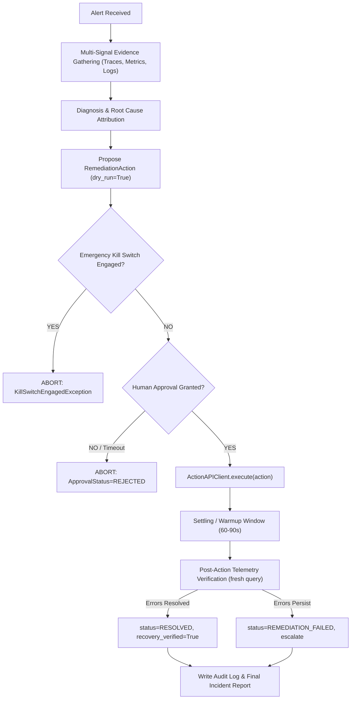

# Bosch Incident Zero — Action API Integration Specification (Day 2 Readiness)

## 1. Context & Safety Boundary

Day 1 focused exclusively on **read-only investigation, telemetry aggregation, and root cause diagnosis**.
Day 2 introduces **active remediation**, which is strictly constrained by competition rules:
1. **Never mutate Feature Flags or Flagd directly**: Modifying `demo.flagd.json` or calling Flagd APIs to remediate is strictly forbidden.
2. **All actions must flow through the official Action API**: Only organizer-sanctioned interfaces may execute remediation.
3. **Mandatory Human-in-the-Loop**: An autonomous agent cannot execute actions unilaterally; explicit human approval is required.
4. **Deterministic Fail-Safe (Emergency Kill Switch)**: A hardware/software kill switch must immediately halt all pending and executing actions.
5. **Post-Remediation Verification**: Remediation is not complete until fresh telemetry verifies that error rates or latencies have returned to baseline.

---

## 2. Existing Interfaces in Codebase

| Component | File Path | Existing Capability |
|---|---|---|
| `RemediationAction` | `src/models/action.py` | Model defining `action_id`, `action_type`, `target_service`, `description`, `parameters`, `requires_approval=True`, `approval_status=PENDING`, `dry_run=True`, `executed_at`, `execution_result`, `recovery_verified`. |
| `ApprovalGate` | `src/approval/gate.py` | Evaluates approval callbacks, enforces `BYPASSED` (if unconstrained) or `APPROVED`/`REJECTED`, defaults to `REJECTED` (fail-closed). |
| `KillSwitch` | `src/remediation/kill_switch.py` | Dual trigger: Environment variable `KILL_SWITCH_ENABLED=true` or sentinel file `.kill_switch`. Raises `KillSwitchEngagedException` instantly. |
| `IncidentReport` | `src/agent/report.py` | Embeds safe remediation proposal with `requires_approval=True`, `approval_status=PENDING`, and `dry_run=True`. |

---

## 3. Required Organizer Contract Items (To Request at 09:00 AM)

To implement the concrete `ActionAPIClient` tomorrow morning without guessing or hardcoding assumptions, the following exact contract details must be obtained from competition mentors:

1. **Endpoint & Base URL:**
   - Base URL (e.g., `http://<host>:<port>/api/v1/actions` or an Envoy-routed ingress).
   - Any proxy or TLS requirements.
2. **Authentication Mechanism:**
   - Bearer token (`Authorization: Bearer <token>`), API Key header (`X-API-Key: ...`), mTLS, or unauthenticated local Docker network.
3. **Action Catalog & Schema:**
   - Allowed action identifiers (e.g. `restart_service`, `scale_deployment`, `rollback_version`, `clear_cache`).
   - JSON payload format for parameters (e.g. `{"service": "payment", "replica_count": 2}`).
4. **Response Contract & Execution Semantics:**
   - Synchronous vs. Asynchronous (`200 OK` with execution output vs. `202 Accepted` with `task_id` for polling).
   - Error code schema on failure (`400 Bad Request`, `409 Conflict`, `500 Internal Error`).
5. **Settling Time & Verification Window:**
   - Recommended wait period before running post-remediation telemetry queries (e.g. 60–90 seconds for container restart / service warmup).

---

## 4. End-to-End Day 2 Execution Pipeline



---

## 5. Implementation Skeleton for Tomorrow

```python
# src/remediation/action_client.py (Template for Day 2 once contract is provided)
class ActionAPIClient:
    def __init__(self, endpoint: str, auth_token: Optional[str] = None, timeout: float = 10.0):
        self.endpoint = endpoint
        self.auth_token = auth_token
        self.timeout = timeout

    def execute(self, action: RemediationAction, kill_switch: KillSwitch, approval_gate: ApprovalGate) -> bool:
        # 1. Enforce Kill Switch
        kill_switch.guard()

        # 2. Enforce Approval Gate
        decision = approval_gate.request_approval(action)
        if decision != ApprovalDecision.APPROVED:
            return False

        # 3. Guard Dry-Run
        if action.dry_run:
            action.execution_result = "DRY_RUN: Action simulated, no network call made."
            return True

        # 4. Dispatch to Official Action API (using verified organizer contract)
        ...
```

