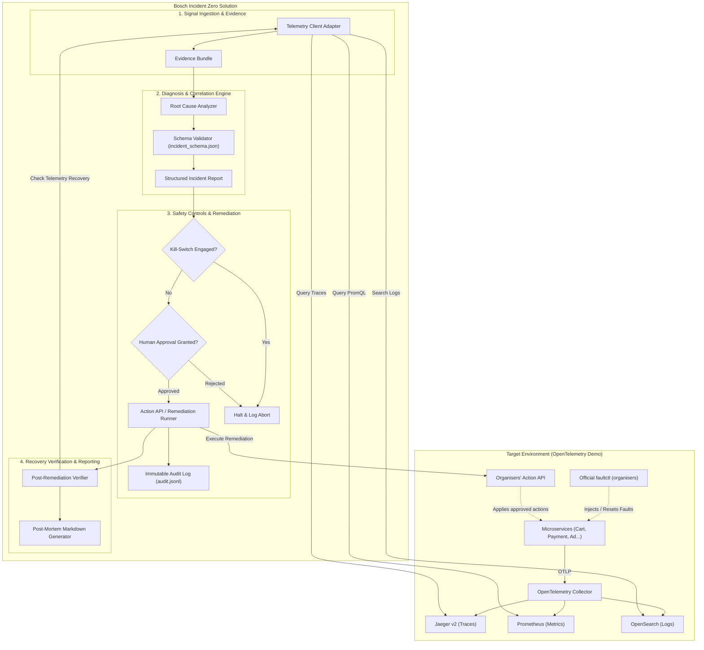

# Bosch Incident Zero — Architecture & System Design

## 1. System Overview

Bosch Incident Zero is designed to operate as an autonomous, closed-loop Site Reliability Engineering (SRE) agent. It interfaces with a target microservice environment (the OpenTelemetry Astronomy Shop) externally, observing system telemetry, diagnosing anomalies, proposing verified remediations, requiring human approval, and enforcing a hard emergency kill-switch.

---

## 2. Core Architectural Principles

### 2.1 Complete Architectural Decoupling
The solution operates as a dedicated peer system rather than embedding agent code inside upstream microservices:
- **Zero In-Tree Upstream Code Modifications:** All demo containers remain upstream standard images.
- **Protocol-Level Integration:** All telemetry retrieval is conducted via documented HTTP/REST endpoints (`/jaeger/ui/api/v3/traces`, `/api/v1/query`, `/*/_search`).
- **Independent Failure Domain:** A fault, exception, or crash in the Incident Zero agent does not degrade customer e-commerce transactions.

### 2.2 Safety Invariants & The Approval Gate
Autonomous remediation in production systems carries risk of cascading failure. Bosch Incident Zero enforces two non-negotiable safety invariants:
1. **The Emergency Kill-Switch:**
   - Evaluated before *every* remediation action.
   - Dual-mode trigger: Environment variable `KILL_SWITCH_ENABLED=true` or presence of sentinel file (default `.kill_switch`).
   - If active, immediate termination of the remediation pipeline with zero network calls to mutation endpoints.
2. **Mandatory Human-in-the-Loop Approval:**
   - Remediations default to `DRY_RUN_MODE=true` or interactive CLI / token approval.
   - Every action requires human sign-off specifying the exact action ID, target service, and predicted effect.

### 2.3 Evidence-Backed Diagnosis
The system rejects speculative diagnoses. A diagnosed root cause must cite:
- At least one specific trace ID containing an error span or latency bottleneck.
- At least one metric metric-name and value showing standard deviation above baseline.
- Correlated log messages if available.
- An explicit confidence score ($0.0 \le c \le 1.0$).

---

## 3. Component Details

### 3.1 Telemetry Ingestion Layer (`src/telemetry/`)
- **`JaegerClient`:** Interfaces with Jaeger v2 API (`/jaeger/ui/api/v3/traces` and `/jaeger/ui/api/v3/services`). Retrieves error traces (`error=true`), root spans, and child trace spans.
- **`PrometheusClient`:** Executes instant PromQL queries and range vectors to calculate error ratios (HTTP 5xx / total requests) and $p95$/$p99$ latencies.
- **`OpenSearchClient`:** Searches log indexes for `ERROR` and `FATAL` level logs matching the service and time window.

### 3.2 Evidence Collector (`src/evidence/`)
- Correlates signals by time window and service name.
- Builds an immutable `EvidenceBundle` containing:
  - Incident trigger metric anomaly.
  - Spanning trace IDs.
  - Log stack traces.
  - Upstream and downstream service topology snapshot.

### 3.3 Root-Cause Diagnosis Engine (`src/diagnosis/`)
- Evaluates the service dependency graph (from `demo.proto` and trace tree).
- Differentiates the **originating fault** from **symptomatic downstream failures** (e.g., checkout failing because payment is unreachable).
- Formats findings into a strongly typed `IncidentReport` validated against `config/incident_schema.json`.

### 3.4 Fault Abstraction Layer (`src/faultctl/`)
- Abstract base class `FaultController` defining standard methods:
  - `inject_fault(fault_id, params)`
  - `revert_fault(fault_id)`
  - `list_active_faults()`
- No implementation ships: the former `FlagdAdapter` edited `src/flagd/demo.flagd.json` directly, which the
  event rules forbid, and was removed. Faults are injected and reset only with the organisers' `faultctl`,
  which the evaluation harness calls through `FAULTCTL_CMD`.

### 3.5 Remediation & Action API (`src/remediation/`)
- Fault injection and reset go only through the official `faultctl`; remediation goes only through the
  organisers' Action API, after human approval.
- Defines standard actions:
  - Feature-flag toggle: only through the organisers' Action API; flagd, `demo.flagd.json` and the
    Feature Flags UI are never touched directly, and flag state is never read.
  - `restart_service`: Triggers service container restart.
  - `rate_limit_service`: Throttles load generator or traffic.
- Every action implements `execute()`, `dry_run()`, and `rollback()`.

### 3.6 Audit Logger & Post-Mortem Generator (`src/audit/` & `src/reporting/`)
- Appends every state transition and human decision to `audit_logs/audit.jsonl`.
- Compiles the completed incident timeline, evidence citations, and verification status into a final Markdown report.
