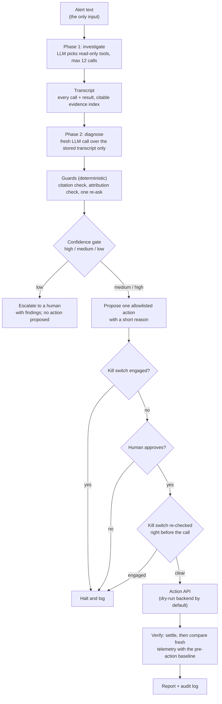

# Architecture overview

One-page summary of how the incident agent works. Details: [AGENT.md](AGENT.md),
[ARCHITECTURE.md](ARCHITECTURE.md), [DECISIONS.md](DECISIONS.md).

## Approach

- **Custom Python agent loop.** No agent framework (no Google ADK) and no MCP server. `src/agent/agent.py`
  drives the model directly through a small provider-neutral wrapper (`src/agent/llm.py`).
- **The LLM reasons and picks tools; code decides what is trusted.** The model chooses which read-only tool
  to call next and writes the diagnosis. Deterministic code checks every citation, sets the confidence
  ceiling, decides escalation, and owns every safety control.
- **Read-only until a human approves.** Investigation never changes the shop. The only path that changes
  the demo is one allowlisted action, sent through the organisers' Action API after explicit human approval.

## Flow

The action, approval and verification boxes describe the Day 2 work in progress; see the README section
"Approval gate and kill switch" for the behaviour as built.

## Components

| Component | File | Role |
|---|---|---|
| LLM wrapper | `src/agent/llm.py` | The only provider-specific file. Anthropic, or any OpenAI-compatible endpoint (OpenAI, Gemini, OpenRouter). Retries with backoff; stops on a daily quota. |
| Tool registry | `src/agent/tools.py` | The 8 read-only tools below. Each result is labelled `ok`, `no_data`, `source_unavailable` or `error`; flag data is stripped. |
| Agent loop | `src/agent/agent.py` | Phase 1 bounded tool loop, phase 2 diagnosis with one retry. |
| Transcript | `src/agent/transcript.py` | Stored record of every call and result; builds the evidence index used for citations. |
| Guards | `src/agent/guards.py` | Diagnosis JSON shape, citation validator, caller-vs-dependency attribution check, confidence gate. |
| Report | `src/agent/report.py` | Maps the diagnosis to `config/incident_schema.json` and validates it. |
| Rule-based analyzer | `src/analysis/` | Deterministic, no-LLM root-cause rules over the same evidence. Tested, not yet wired into the CLI. |
| Approval and safety | `src/approval/`, `src/remediation/` | Approval gate, kill switch, action layer, verification. |
| Evaluation harness | `src/agent/eval_harness.py` | Injects with the official `faultctl`, runs the agent on the alert only, scores against evaluator-only answers. |

## The 8 tools

| Tool | Reads |
|---|---|
| `system_overview` | Every service's request rate, error rate, latency, CPU, memory and container state, most anomalous first (Prometheus) |
| `get_service_metrics` | One service's operations in detail, plus CPU and memory trends (Prometheus) |
| `dependency_map` | Who calls whom: the static demo topology, not live-observed |
| `search_traces` | Failing or slow requests for a service (Jaeger) |
| `get_trace` | One trace's deepest failing step; flags a call that never reached its callee (Jaeger) |
| `search_logs` | Error and warning logs (OpenSearch) |
| `container_health` | Running state, restarts, out-of-memory kills (Docker) |
| `deploy_history` | Always `source_unavailable`: no deploy source exists |

## How it decides

1. **Citations.** Every trace ID, span, log line, metric value and container fact the diagnosis cites must
   appear in a stored tool result. Invented ones are rejected.
2. **Attribution.** If traces show the caller's request never reached a dependency, blaming the caller is
   flagged: the dependency is the root cause and the caller is impacted.
3. **One re-ask.** On any problem the model gets one chance to correct itself; anything still invalid is
   dropped.
4. **Confidence gate** (fixed rules, not the model's opinion):
   - **high**: two independent validated signal types, one alternative ruled out with cited evidence, and
     no invalid citations;
   - **medium**: one validated signal type plus at least one more validated item;
   - **low**: anything else. Low confidence, every source unavailable, or a misattributed root cause
     escalates to a human instead of guessing.

## Safety controls

- **Human approval is compulsory** before any action. No flag or default approves on the human's behalf.
- **Kill switch**: the `KILL_SWITCH_ENABLED` environment variable, the `.kill_switch` sentinel file or the
  approval page's Kill button halts every action. It is checked at plan time, right after approval and
  immediately before the action is sent.
- **Allowlist**: one diagnosis maps to at most one allowlisted action plus its rollback, approved together;
  an escalation proposes nothing.
- **Verification never overclaims**: a dry run is reported as `NOT_VERIFIED_DRY_RUN`, never as recovered;
  a failed recovery runs the pre-approved rollback and escalates.
- **Action API only**: no direct edits to flagd, `demo.flagd.json` or the Feature Flags UI, and no tool reads
  flag state. Faults are injected and reset only with the organisers' `faultctl`.
- **Dry run by default** until the organisers' Action API contract is available.
- **Audit trail**: `incident_output/<run-id>/transcript.json` and `report.json` for every run, plus the
  action audit log.
- Every safety control is deterministic code, never an LLM decision.
