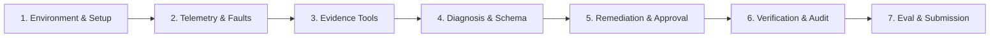

# Bosch Incident Zero — Implementation Roadmap

**Project:** Autonomous SRE Incident Diagnosis & Remediation Solution  
**Target Environment:** OpenTelemetry Astronomy Shop Demo  
**Strategy:** Prioritized, test-driven, decoupled delivery  

---

## Roadmap Overview

---

## Stage 1: Environment Setup and Baseline Verification

- **Objective:** Establish the separate solution workspace (`bosch-incident-zero/`), verify connectivity to the local development environment, and configure cross-platform execution tooling.
- **Expected Deliverable:**
  - Standalone `bosch-incident-zero/` directory structure with independent `pyproject.toml` / `requirements.txt`, `.env.example`, `.gitignore`, and documentation.
  - Cross-platform environment verification script (`scripts/verify_environment.py` and `scripts/verify_environment.ps1`) checking Docker, Python, and network port availability.
- **Dependencies:** Python 3.11+ installed; Docker Desktop daemon running.
- **Acceptance Criterion:**
  - Running `python scripts/verify_environment.py` passes all local checks, reports status of Docker daemon and demo ports, and produces structured JSON status output without unhandled exceptions.

---

## Stage 2: Telemetry Access and Incident Reproduction

- **Objective:** Establish reliable programmatic access to Jaeger, Prometheus, and OpenSearch, and automate failure injection using the available upstream fault mechanisms (`flagd`).
- **Expected Deliverable:**
  - Telemetry client libraries in `src/telemetry/`:
    - `jaeger_client.py`: Query trace list, trace spans, and error traces.
    - `prometheus_client.py`: Execute PromQL queries (e.g., error rate, request duration, CPU/memory).
    - `opensearch_client.py`: Search application logs filtered by service name and severity (`ERROR`/`WARN`).
  - Fault injection client in `src/faultctl/`:
    - `fault_injector.py`: Programmatic toggle for `demo.flagd.json` failure scenarios (e.g., `cartFailure`, `adHighCpu`, `paymentFailure`).
- **Dependencies:** Stage 1 complete; OpenTelemetry Demo running with observability stack (`compose.yaml` + `compose.observability.yaml`).
- **Acceptance Criterion:**
  - Injecting `cartFailure` via `fault_injector.py` triggers elevated HTTP 500 errors detectable via `prometheus_client.py` and produces error spans retrievable via `jaeger_client.py` within 60 seconds.

---

## Stage 3: Evidence-Gathering Tools

- **Objective:** Build an autonomous evidence-collection engine that systematically aggregates signals across traces, metrics, and logs when an anomaly or incident is detected.
- **Expected Deliverable:**
  - `src/evidence/collector.py`: Orchestrator querying RED metrics (Rate, Errors, Duration), pinpointing failing trace IDs, and extracting correlated log stack traces.
  - `src/models/evidence.py`: Pydantic data models structuring gathered evidence with timestamps, metric data points, and trace links.
- **Dependencies:** Stage 2 telemetry clients.
- **Acceptance Criterion:**
  - Given an active incident alert on a service, `collector.gather_evidence(service_name)` returns a complete `EvidenceBundle` containing at least 1 failing trace ID, relevant error log entries, and the delta in error rate or latency compared to baseline.

---

## Stage 4: Root-Cause Diagnosis and Structured Output

- **Objective:** Implement root-cause analysis logic (rule-based heuristic engine combined with LLM reasoning) and format findings into a validated structured incident report.
- **Expected Deliverable:**
  - `src/diagnosis/analyzer.py`: Correlates evidence bundle across service dependency graphs (e.g., frontend failure caused by downstream payment gRPC failure).
  - `config/incident_schema.json`: Formal JSON Schema defining the required incident report fields.
  - `src/models/report.py`: Pydantic model enforcing schema compliance (incident ID, timestamp, root cause summary, affected services, confidence score, evidence citations, suggested actions).
- **Dependencies:** Stage 3 evidence bundle.
- **Acceptance Criterion:**
  - Validating the output of `analyzer.diagnose(evidence)` against `config/incident_schema.json` succeeds with 0 validation errors across standard demo failure modes (`cartFailure`, `paymentFailure`, `adHighCpu`).

---

## Stage 5: Safe Remediation, Approval Gate, and Action API Integration

- **Objective:** Implement remediation execution protected by a mandatory human approval workflow and an immediate emergency kill-switch.
- **Expected Deliverable:**
  - `src/remediation/action_api.py`: Pluggable Action API interface supporting actions like flag deactivation, service restart, rate-limiting, and configuration rollback.
  - `src/approval/gate.py`: Interactive approval gate requiring explicit human confirmation (CLI confirmation or secure token) before executing remediation.
  - `src/remediation/kill_switch.py`: Global kill-switch mechanism (file sentinel or environment toggle `KILL_SWITCH_ENABLED=true`) that blocks any remediation command immediately.
- **Dependencies:** Stage 4 recommended actions.
- **Acceptance Criterion:**
  - When `kill_switch.is_active()` is `True`, any call to `action_api.execute()` immediately raises `KillSwitchEngagedException` and performs zero system modifications.
  - Unapproved actions are rejected; approved actions execute the corresponding rollback (e.g., turning off `cartFailure` in flagd).

---

## Stage 6: Recovery Verification, Audit Logging, and Post-Mortem Generation

- **Objective:** Automatically verify that the system has recovered post-remediation, log every action taken to an immutable audit trail, and generate a markdown post-mortem report.
- **Expected Deliverable:**
  - `src/verification/health_check.py`: Re-probes telemetry signals (error rate drops to 0%, latency returns to baseline) over a stabilization window.
  - `src/audit/logger.py`: Structured JSON audit log capturing every event: detection, diagnosis, approval prompt, human response, remediation execution, and recovery verification.
  - `src/reporting/post_mortem.py`: Generates human-readable Markdown post-mortem document.
- **Dependencies:** Stage 5 remediation engine.
- **Acceptance Criterion:**
  - Post-remediation health check verifies traffic recovery within the stabilization window, records all steps in `audit.jsonl`, and renders a complete post-mortem markdown file containing timeline and evidence citations.

---

## Stage 7: Testing, Evaluation, and Submission Preparation

- **Objective:** End-to-end testing across all demo failure scenarios, benchmarking diagnosis accuracy and mean time to remediate (MTTR), and finalizing documentation.
- **Expected Deliverable:**
  - Test suite in `tests/` covering unit tests, contract mocks, and end-to-end scenario simulations.
  - Submission packaging script and final demonstration guide.
- **Dependencies:** Stages 1 through 6.
- **Acceptance Criterion:**
  - Full test suite passes (`pytest tests/`).
  - End-to-end dry-run demonstrates detection -> diagnosis -> approval -> remediation -> recovery verification on at least 3 distinct fault injection scenarios without human code modifications.
