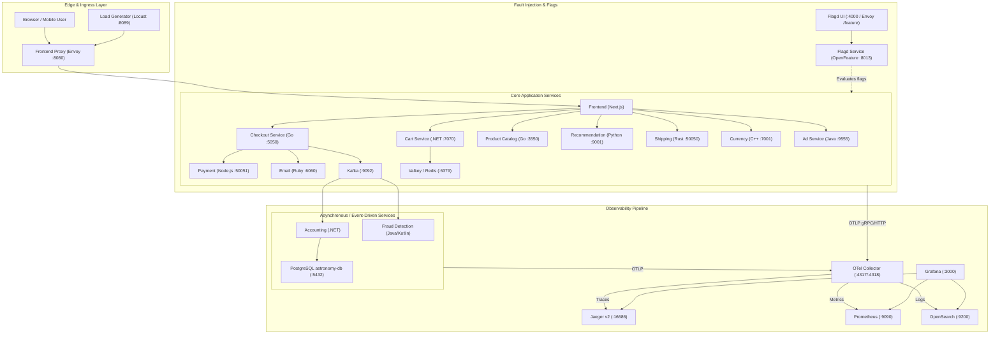

# OpenTelemetry Demo Repository Audit

**Target System:** [OpenTelemetry Astronomy Shop Demo](https://github.com/open-telemetry/opentelemetry-demo)  
**Project Context:** Bosch Hackathon — Project Incident Zero  
**Audit Date:** October 2026  
**Auditor:** Senior Software Architect & Repository Engineer  

---

## 1. Executive Summary & Git Repository Context

A forensic audit of the checked-out workspace reveals:

- **Repository Origin:** Direct clone of the official upstream OpenTelemetry Demo (`https://github.com/open-telemetry/opentelemetry-demo.git`).
- **Remote Configuration:**
  - `origin`: `https://github.com/open-telemetry/opentelemetry-demo.git` (fetch & push)
- **Branch:** `main` (tracking `origin/main`).
- **Commit SHA:** `ad06a6f9df40abde6c1f0c58b29b92f1076a74ec` (*"[ci] Require a changelog fragment on PRs unless Skip Changelog is set (#4153)"*).
- **Working Tree Status:** Clean; no untracked files, no stash entries, no upstream modifications.
- **Repository Classification:** This is **pure upstream code**. It is **not** a customized fork, nor does it contain any pre-configured starter code from Bosch or the hackathon organizers.

---

## 2. System Architecture & Component Mapping

The repository implements the **Astronomy Shop**, a polyglot microservice e-commerce application designed to demonstrate OpenTelemetry tracing, metric collection, and log aggregation across heterogeneous runtimes.



### 2.1 Microservice Inventory

| Service | Runtime / Framework | Communication Protocols | Key Upstream Function |
| :--- | :--- | :--- | :--- |
| **frontend** | Next.js / TypeScript | HTTP / SSR, calls backend gRPC | User interface and BFF (Backend For Frontend) |
| **frontend-proxy** | Envoy Proxy | HTTP / Reverse Proxy | Ingress router for all public web endpoints (`:8080`) |
| **ad** | Java 21 / Gradle | gRPC (`:9555`), HTTP Prometheus (`:9465`) | Serves contextual ads |
| **cart** | .NET 8 / C# | gRPC (`:7070`), Valkey client | Manages shopping cart state stored in Valkey |
| **checkout** | Go 1.23 | gRPC (`:5050`), Kafka producer | Coordinates cart checkout, payment, shipping, email |
| **currency** | C++ | gRPC (`:7001`) | Converts currency rates |
| **email** | Ruby | gRPC (`:6060`) | Sends order confirmation emails |
| **payment** | Node.js / Express | gRPC (`:50051`) | Validates and charges credit card transactions |
| **product-catalog** | Go 1.23 | gRPC (`:3550`) | Serves product listings from JSON/memory |
| **quote** | PHP | HTTP (`:8090`) | Computes shipping quotes based on cart items |
| **recommendation** | Python 3.11 | gRPC (`:9001`) | Generates product recommendations |
| **shipping** | Rust | gRPC (`:50050`) | Calculates shipping quotes and tracking IDs |
| **accounting** | .NET 8 / C# | Kafka consumer, PostgreSQL client | Records processed orders into SQL database |
| **fraud-detection** | Java 21 / Gradle | Kafka consumer | Analyzes order stream for suspicious activity |
| **load-generator** | Python / Locust | HTTP / Locust web UI (`:8089`) | Simulates realistic customer traffic patterns |
| **image-provider** | Go | HTTP (`:8081`) | Serves static product images |

### 2.2 Observability and Control Infrastructure

| Component | Port(s) | Role & API Surface |
| :--- | :--- | :--- |
| **otel-collector** | `4317` (gRPC), `4318` (HTTP), `8888` (metrics) | Central collector; routes OTLP traces, metrics, logs to backends. |
| **jaeger** | `16686` (UI & API), `4317` (collector) | Tracing backend; exposes trace query API at `/jaeger/ui/api/v3/traces`. |
| **prometheus** | `9090` (PromQL API & UI) | Metrics backend; exposes query API at `/api/v1/query` and `/api/v1/query_range`. |
| **opensearch** | `9200` (REST API), `9600` (performance) | Log storage; exposes standard Elasticsearch/OpenSearch JSON query API at `/*/_search`. |
| **grafana** | `3000` (UI) | Pre-configured dashboards for traces, metrics, logs, and self-observability. |
| **flagd** | `8013` (gRPC), `8016` (OFREP) | Feature flag and fault injection daemon configured via `demo.flagd.json`. |
| **flagd-ui** | `4000` | Web UI for toggling feature flags interactively. |
| **opamp-server** | `4321` | Open Agent Management Protocol server managing collector configurations. |

### 2.3 Upstream Agentic Layer (`compose.agent.yaml`)

The repository includes an experimental "agentic" layer under `src/agent`, `src/mcp`, and `src/chatbot`. **Audit analysis confirms that this layer is NOT an incident responder:**

1. **`agent` (FastAPI / LangGraph):** An end-user shopping assistant that accepts queries like *"What currencies are supported?"* or *"List available products"* (`POST /prompt`). It utilizes Traceloop for LLM tracing and VCR cassettes for deterministic replay.
2. **`mcp` (FastMCP / Python):** A Model Context Protocol server exposing read-only product catalog tools to the shopping agent.
3. **`chatbot` (Gradio / Streamlit):** A user-facing chat widget embedded in the shopping frontend.

> [!WARNING]
> None of the upstream agent components implement SRE incident diagnosis, remediation, fault management, or system telemetry analysis. They represent customer-facing retail capabilities. Bosch Incident Zero requires a distinct, specialized architectural stack.

---

## 3. Existing Functionality Reusable for Bosch Incident Zero

Although Bosch-specific logic is absent, the repository provides substantial infrastructure ready for direct reuse:

1. **Rich Microservice Ecosystem:** 14+ services spanning multiple runtimes, providing realistic multi-tier distributed failure surfaces.
2. **Built-in Fault Injection (`src/flagd/demo.flagd.json`):**
   Over 20 pre-configured failure modes can be triggered dynamically via Flagd or HTTP:
   - `adFailure`: Fails ad service gRPC calls.
   - `cartFailure`: Introduces fractional failures (10% to 100%) in cart operations.
   - `paymentFailure` & `paymentUnreachable`: Simulates payment processing outages.
   - `emailMemoryLeak`: Induces progressive memory consumption in Ruby email service.
   - `kafkaConsumerDead` & `kafkaQueueProblems`: Simulates Kafka partition/lag degradation.
   - `adHighCpu`: Induces CPU starvation in the Java ad service.
   - `productCatalogLockContention`: Simulates DB lock contention on product catalog.
3. **Comprehensive Telemetry Pipeline:**
   - **Traces:** Available in Jaeger v2 via REST API (`/jaeger/ui/api/v3/traces`).
   - **Metrics:** Available in Prometheus via PromQL API (`/api/v1/query`).
   - **Logs:** Available in OpenSearch via search API (`http://localhost:9200/*/_search`).
   - **Collector Exporter Extension Point (`compose.extras.yaml` & `otelcol-config-extras.yml`):** Upstream provides empty extension seams explicitly intended for custom pipelines without touching upstream files.
4. **Automated Integration Test Harness (`test/telemetry/`):**
   - Pytest test runner (`conftest.py`, `services.py`) that queries Jaeger, Prometheus, and OpenSearch to verify signal ingestion.
   - Can be used as a reference for querying observability backends programmatically.

---

## 4. Bosch-Specific Functionality to Implement

A comprehensive search of the repository confirms that **no Bosch-specific files or specifications exist** in this repository. Specifically:

| Requirement Mentioned | Repository Status | Architectural Action Required |
| :--- | :--- | :--- |
| **`faultctl` CLI / Daemon** | **Not Found** | Abstract fault injection behind a pluggable interface that currently bridges to `flagd` and can adapt to `faultctl` when provided. |
| **Action API / Remediation Interfaces** | **Not Found** | Define an extensible `ActionAPI` abstraction with safety guards, dry-run capabilities, and reversible actions (e.g., flag reset, service restart, rate limiting). |
| **Structured Incident Report Schema** | **Not Found** | Define a validated JSON/Pydantic incident schema capturing incident ID, timestamp, affected services, root cause, confidence score, evidence citations (trace IDs, metric queries, log excerpts), and recommended actions. |
| **Human Approval Mechanism** | **Not Found** | Implement a mandatory approval gate (CLI prompt or token verification) that prevents destructive or remediation actions from firing autonomously. |
| **Emergency Kill-Switch** | **Not Found** | Implement a global fail-safe switch (`KILL_SWITCH_ENABLED=true` or sentinel file) that immediately halts all active autonomous remediation actions. |
| **Audit Logging & Post-Mortem Generator** | **Not Found** | Implement persistent audit trail logging for all diagnosis and remediation steps, generating markdown/JSON post-incident reports. |

---

## 5. Development Starting Point & Strategy

### 5.1 The Rational Starting Point

The development starting point is **establishing a separate solution workspace (`bosch-incident-zero/`)** that interacts with the OpenTelemetry Demo strictly over defined network boundaries:

1. **Preserve Upstream Integrity:** Upstream `compose.yaml`, `src/`, `test/`, and `telemetry-schema/` remain unmodified.
2. **External Integration Surface:**
   - Observability Ingestion: Jaeger REST API (`http://localhost:16686`), Prometheus API (`http://localhost:9090`), OpenSearch REST API (`http://localhost:9200`).
   - Fault Controller: Flagd OFREP / gRPC API (`http://localhost:8013` / `:8016`) or direct flag file manipulation (`src/flagd/demo.flagd.json`).
   - Service Probing: Envoy Gateway (`http://localhost:8080`).
3. **Pluggable Architecture:** Build adapters for missing Bosch contracts (`faultctl`, Action API) so the solution works immediately with Flagd and Docker while seamlessly swapping to official hackathon interfaces upon delivery.

---

## 6. Verified Execution and Testing Commands

### 6.1 Docker Compose Commands (Cross-Platform / Windows PowerShell)

Because `make` is not natively installed on Windows hosts without MinGW/WSL, use these verified `docker compose` commands directly:

```powershell
# 1. Start core demo with Kafka and full Observability Stack (Jaeger, Prometheus, OpenSearch, Grafana):
docker compose --env-file .env --env-file .env.override `
  -f compose.yaml -f compose.full.yaml -f compose.observability.yaml up -d

# 2. Start minimal demo (Core + Observability, lower resource usage):
docker compose --env-file .env --env-file .env.override `
  -f compose.yaml -f compose.observability.yaml up -d

# 3. Check status of all containers:
docker compose ps

# 4. View logs for a specific service (e.g., cart):
docker compose logs -f cart

# 5. Stop the entire demo and remove volumes:
docker compose --env-file .env --env-file .env.override `
  -f compose.yaml -f compose.full.yaml -f compose.observability.yaml down --remove-orphans --volumes
```

### 6.2 Service Access Endpoints

Once running, the demo exposes the following entry points on `localhost`:

- **Web Store (Frontend):** `http://localhost:8080/`
- **Jaeger UI:** `http://localhost:8080/jaeger/ui/` (direct: `http://localhost:16686/`)
- **Grafana Dashboards:** `http://localhost:8080/grafana/` (direct: `http://localhost:3000/`, admin/admin)
- **Prometheus UI:** `http://localhost:9090/`
- **OpenSearch API:** `http://localhost:9200/`
- **Feature Flags (Flagd UI):** `http://localhost:8080/feature/` (direct: `http://localhost:4000/`)
- **Load Generator UI:** `http://localhost:8080/loadgen/` (direct: `http://localhost:8089/`)
- **Telemetry Documentation:** `http://localhost:8080/telemetry/`

### 6.3 Existing Upstream Tests

- **Telemetry Signal Sanity Tests:**
  Implemented in `test/telemetry/`. Validates that services emit traces, metrics, and logs to Jaeger, Prometheus, and OpenSearch.
  ```powershell
  # Requires running demo
  docker build -t opentelemetry-demo-telemetry-tests ./test/telemetry
  docker run --rm --network opentelemetry-demo --env-file .env -e TEST_SCOPE=full opentelemetry-demo-telemetry-tests
  ```
- **Frontend Cypress Tests:**
  Configured in `compose.tests.yaml` and `src/frontend/Dockerfile.cypress`.
  ```powershell
  docker compose -f compose.yaml -f compose.tests.yaml run frontendTests
  ```

---

## 7. Component Classification Matrix

| Component / Subsystem | Path / Service | Classification | Role in Bosch Incident Zero |
| :--- | :--- | :--- | :--- |
| **Astronomy Shop Services** | `src/{cart,checkout,ad,...}` | Upstream Service | Target microservices to be monitored and diagnosed |
| **OTel Collector** | `src/otel-collector/` | Upstream Pipeline | Ingestion pipeline routing telemetry to storage |
| **Jaeger v2** | `compose.observability.yaml` | Reusable Dependency | Primary source for distributed trace & error inspection |
| **Prometheus v3** | `compose.observability.yaml` | Reusable Dependency | Primary source for RED metrics (Rate, Errors, Duration) |
| **OpenSearch 2** | `compose.observability.yaml` | Reusable Dependency | Primary source for application and access logs |
| **Flagd / demo.flagd.json** | `src/flagd/` | Reusable Dependency | Fault injection engine to simulate incident scenarios |
| **Telemetry Test Suite** | `test/telemetry/` | Reusable Reference | Code examples for programmatic Jaeger/Prometheus queries |
| **Upstream Retail Agent** | `src/agent/`, `src/mcp/` | Upstream (Irrelevant) | Shopping assistant; out of scope for SRE incident response |
| **`faultctl`** | N/A | Missing Bosch Spec | Needs adapter layer bridging to Flagd / future binary |
| **Action API** | N/A | Missing Bosch Spec | Needs contract definition & safe execution engine |
| **Incident Diagnosis Agent** | N/A | Bosch Implementation | Core solution to analyze telemetry and find root causes |
| **Approval Gate & Kill-Switch** | N/A | Bosch Implementation | Mandatory safety controls before executing remediations |
| **Incident Report Generator** | N/A | Bosch Implementation | Output generator producing structured post-incident reports |

---

## 8. Risks, Constraints, and Unknowns

1. **Docker Daemon Status:**
   Docker CLI version 29.7.2 is installed, but the Docker Desktop daemon was not running during the initial audit on the host machine. Docker Desktop must be running prior to starting the demo containers.
2. **Resource Footprint:**
   Running the full demo stack (`compose.yaml` + `compose.full.yaml` + `compose.observability.yaml`) involves ~25 containers consuming 6GB–10GB RAM. For constrained machines, `start-minimal` (`compose.yaml` + `compose.observability.yaml`) avoids Kafka and reduces memory consumption significantly.
3. **Absence of Hackathon Starter Contracts:**
   Neither `faultctl` nor the official Action API specification or incident JSON schema are present in this repository. Our solution must define clean, strongly typed interfaces that operate immediately with Flagd/Docker while allowing immediate configuration of alternative endpoints once announced by organizers.
4. **Make Availability:**
   `make` is not installed on the default Windows PowerShell path. All project scripts, documentation, and automation must provide native PowerShell and cross-platform Python scripts rather than relying exclusively on Makefile targets.
