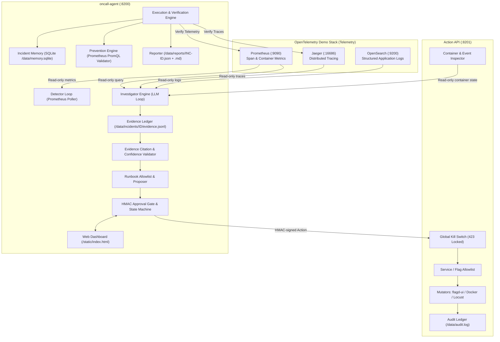

# Architecture of the AI On-Call Engineer

This document outlines the architecture, components, decision engine, tool inventory, and safety controls of the autonomous AI On-Call Engineer designed for the OpenTelemetry Astronomy Shop demo.

---

## 1. System Overview

The system is structured as two decoupled Docker Compose services residing in the `opentelemetry-demo` bridge network, communicating with the demo telemetry tier and each other:

---

## 2. Core Components

### A. Action API (`src/action-api/`, `:8201`)
The **sole write authority** and control plane. No mutating action in the system can bypass it.
- **Mutual Isolation:** Only `action-api` mounts the Docker socket (`/var/run/docker.sock`) and can talk to `flagd-ui` (`:4000`) or `load-generator` (`:8089`).
- **Safety Gateways:**
  1. **Kill Switch:** When engaged, every mutating action immediately aborts with `HTTP 423 Locked`.
  2. **Allowlist:** Only allowed business services (`payment`, `cart`, `product-catalog`, etc.) may be restarted or modified. Core observability components (`otel-collector`, `prometheus`, `jaeger`, `opensearch`, `flagd`, `action-api`, `oncall-agent`) can **never** be touched.
  3. **HMAC-SHA256 Token Validation:** All mutating calls require a valid HMAC token bound to `{incident_id, action, params, exp}`.
  4. **Audit Trail:** Every incoming call (dry-run or live) is synchronously appended to `/data/audit.log`.

### B. oncall-agent (`src/oncall-agent/`, `:8200`)
The autonomous AI engineer hosting background loops, the investigation agent, approval state machine, and web dashboard.
- **Detector:** Runs in a daemon thread polling Prometheus span metrics (`traces_span_metrics_calls_total`) every 30s. Triggers an alert when error rates exceed 5% across consecutive polls or p95 latency exceeds 3× baseline. Alerts specify **symptoms only**; they never guess root causes or flags.
- **Evidence Ledger:** Every tool call output is assigned an immutable ID (`E1`, `E2`, ...) and written to `/data/incidents/<id>/evidence.jsonl`.
- **Investigator Loop:** Adaptive LLM agent equipped with read-only tools. Synthesizes metrics, traces, logs, and container stats into a structured diagnosis.
- **Evidence Validator:** Deterministic code that verifies every cited evidence ID exists, every cited substring/metric value is present in raw output (no fabricated evidence), penalizes unrefuted alternatives, and calibrates confidence score.
- **Runbook Proposer:** Strictly chooses remediation actions from `runbook.yaml` allowlist, prioritized least-invasive first (flags/throttling before restarts).
- **Approval Gate & Dashboard:** Human-in-the-loop dashboard (`/static/index.html`) displaying symptoms, live Jaeger trace links, calibrated confidence, dry-run button, approve/reject buttons, and global kill switch.
- **Executor & Verifier:** Dispatches approved actions to Action API with HMAC token, waits `ONCALL_SETTLE_S` (60s), and verifies recovery using fresh telemetry (error ratio < 2%, stable containers, zero error traces). Automatically executes rollback if verification fails.
- **Incident Memory (Stretch A):** SQLite database (`/data/memory.sqlite`) tracking historical incidents and outcomes. Used as a hint to accelerate investigation without substituting for live evidence.
- **Prevention Engine (Stretch B):** Formulates concrete non-applied alerting rules (with PromQL live-validated against Prometheus), compose config changes, and architectural resilience recommendations.
- **Reporter:** Outputs JSON reports (validated against JSON Schema Draft 2020-12) and executive Markdown summaries under `/data/reports/`.

---

## 3. Tool Inventory (Read-Only)

All tools exposed to the agent LLM are strictly read-only and enforce compact token outputs:

| Tool | Backend Source | Returned Content |
|---|---|---|
| `get_health_overview(lookback_min)` | Prometheus span metrics | Anomaly-ranked table: service, req rate, error %, p95, baseline ms. |
| `query_prometheus(promql, lookback_min)` | Prometheus API | Truncated series summary (min, max, latest, trend). |
| `search_traces(service, error_only, limit)` | Jaeger REST API | Compact list of trace IDs, root operations, error spans. |
| `get_trace(trace_id)` | Jaeger REST API | Compact span tree with HTTP/gRPC/DB attributes. **`feature_flag.*` stripped**. |
| `search_logs(service, severity, text, limit)`| OpenSearch REST API | Deduped log lines with counts, first/last seen, trace IDs. |
| `get_container_health(service)` | Action API Inspector | State, restart count, OOM exit codes, CPU/mem usage. |
| `get_recent_changes(lookback_min)` | Action API Event Log | Container start/stop/restart events and actions taken. |
| `search_incident_memory(symptom_summary)`| Local SQLite DB | Top-3 similar past incidents, similarity score, and effective fixes. |
| `submit_diagnosis(...)` | Terminal Tool | Structured diagnosis payload with cited evidence IDs and alternatives. |

---

## 4. Safety Controls Matrix

| Safety Control | Implementation Point | Enforcement Mechanism |
|---|---|---|
| **Zero Flag Reading (Rule 1)** | Tool layer & Jaeger parser | Strips `feature_flag.*` attributes; bans flagd API queries or flag file reads. |
| **No Direct Mutations (Rule 2 & 3)** | Docker network & permissions | LLM has zero write tools. `oncall-agent` has no Docker socket. Writes pass through `action-api`. |
| **Human-in-the-Loop (Rule 4)** | Approval State Machine | Mutating actions require explicit operator approval; HMAC token minted only upon approval. |
| **Anti-Hallucination (Rule 5 & 6)** | Deterministic Validator | Strict string & value verification against evidence ledger; calibrated confidence penalties. |
| **Replay & Tamper Protection** | HMAC-SHA256 Token | Tokens bind incident ID, specific action, exact params, and expiration timestamp. |
| **Emergency Halt** | Global Kill Switch | Action API rejects all mutating calls immediately with `423 Locked`. |
| **Safe Recovery & Rollback** | Executor Verifier | Actions automatically rollback if post-remediation error rates remain elevated. |
