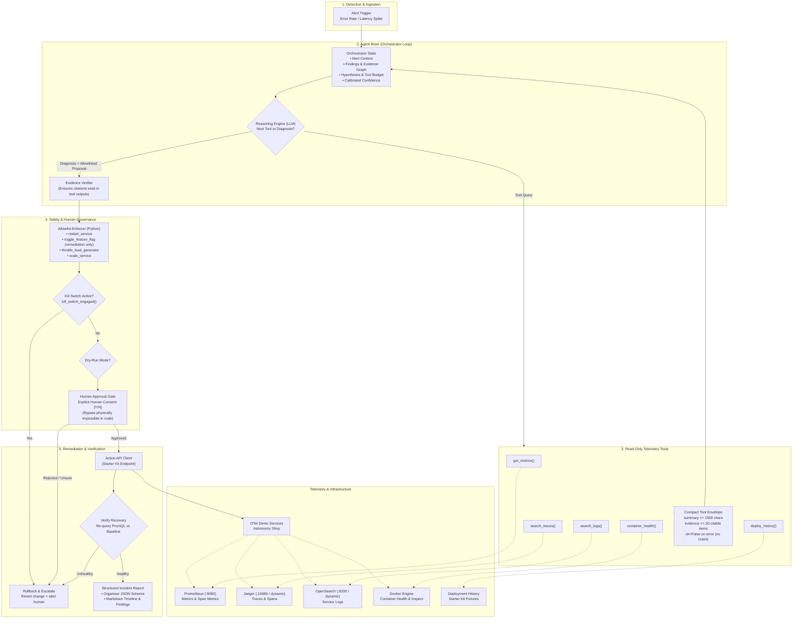

# Incident Zero: AI On-Call Engineer — Architecture Overview

> **Target**: 1-Page Architecture Sketch for **Checkpoint 1 (CP1: Eyes)** & Final System Documentation  
> **Repository**: OpenTelemetry Demo ("Astronomy Shop") Autonomous Remediation Agent  
> **Specification**: [docs/hackathon/interfaces.md](interfaces.md) | [docs/hackathon/RULES.md](RULES.md)

---

## 1. System Architecture Diagram



---

## 2. Core Components

| Component | Module | Responsibilities | Key Safety & Operational Constraints |
|---|---|---|---|
| **Alert Ingestion & State** | `oncall/agent/` | Receives initial trigger (error-rate or latency spike). Initialises investigation state, hypotheses, and tool call budget (max 10 calls). | Read-only. Does not assume root cause at trigger time. |
| **Reasoning Engine (Brain)** | `oncall/agent/` | Dynamic step-by-step investigation loop. Selects next best tool based on prior findings rather than massive prompt context dumping. | Must escalate to human if confidence is low, contradictory, or multi-component failure. |
| **Read-Only Tools** | `oncall/tools/` | Provides typed telemetry tools querying Prometheus, Jaeger, OpenSearch, Docker, and deploys. | **Strictly prohibited from reading `flagd`** or flag configs. Never crashes callers (`ok=False`). Returns compact envelopes. |
| **Evidence Verifier** | `oncall/agent/` | Validates that every trace ID, span, log line, or metric cited in diagnosis exists verbatim in tool run logs. | **Direct prevention against invented evidence penalties.** |
| **Safety Layer** | `oncall/safety/` | In-code Python barrier enforcing action allowlist, kill switch, dry-run mode, and human approval. | **LLM has zero code path to bypass.** Plain Python gates block unauthorised execution. |
| **Action API Client** | `oncall/safety/` | Interacts with official organisers' Action API to execute approved remediations. | The **only** permitted mechanism to touch system state. No direct docker/k8s mutation. |
| **Verification & Rollback** | `oncall/safety/` | Tests system telemetry against baseline post-remediation. Auto-rollbacks if recovery fails within timeout. | Guarantees self-healing or failsafe escalation. |
| **Run Log & Reporter** | `eval/`, `reports/` | Formats final incident report matching mandatory organisers' JSON schema and markdown audit log. | Full reproducibility and transparent decision audit trail. |

---

## 3. Read-Only Telemetry Tools & Contracts

All tools return a standard compact envelope matching [`docs/hackathon/interfaces.md`](interfaces.md):

```python
{
  "tool": str,              # Tool name, e.g. "get_metrics"
  "ok": bool,               # False on error (tools NEVER raise uncaught exceptions)
  "query": dict | str,      # Exact query/params executed (for evidence citation)
  "summary": str,           # Human & LLM readable summary (<= 1500 chars)
  "evidence": [             # Concrete verifiable artefacts (<= 20 items)
    {
      "id": str,            # e.g. "metric:<promql>@<iso_ts>", "trace:<id>/span:<name>"
      "text": str,          # Verbatim excerpt (log line, metric value, status)
      "ts": str | None      # ISO timestamp
    }
  ],
  "error": str | None       # Error explanation if ok == False
}
```

### Tool Inventory
1. **`get_metrics(service, metric, window_min=15)`**  
   Queries Prometheus (`http://localhost:9090`) for error rates, request rates, latencies (p50/p95/p99), and CPU/memory deltas vs. baseline.
2. **`search_traces(service, only_errors=True, limit=20)`**  
   Queries Jaeger API to identify failing traces, error spans, status codes, and cross-service call latencies.
3. **`search_logs(service, level="error", window_min=15, limit=50)`**  
   Queries OpenSearch for structured error log lines, exceptions, and stack traces.
4. **`container_health(service=None)`**  
   Checks Docker container health, restart counts, OOM kills, CPU/memory throttling, and exit codes.
5. **`deploy_history(window_min=60)`**  
   Retrieves recent configuration changes, service restarts, or mock deployment events.

---

## 4. How the Agent Decides (Reasoning & Hypothesis Testing)

```
        ┌────────────────────────────────────────────────────────┐
        │ 1. Alert Received (e.g. checkoutservice latency spike)  │
        └──────────────────────────┬─────────────────────────────┘
                                   ▼
        ┌────────────────────────────────────────────────────────┐
        │ 2. Form Initial Hypotheses                             │
        │    - H1: Downstream dependency failure (payment/cart)  │
        │    - H2: Resource starvation / OOM crash               │
        │    - H3: Configuration or application bug              │
        └──────────────────────────┬─────────────────────────────┘
                                   ▼
        ┌────────────────────────────────────────────────────────┐
        │ 3. Targeted Investigation Loop (Max 10 steps)          │
        │    Step A: search_traces() -> Find root error span     │
        │    Step B: search_logs()   -> Extract stack trace      │
        │    Step C: get_metrics()   -> Check latency delta      │
        └──────────────────────────┬─────────────────────────────┘
                                   ▼
        ┌────────────────────────────────────────────────────────┐
        │ 4. Calibrated Confidence Scoring                       │
        │    - High (>= 0.85): Evidence directly confirms cause   │
        │    - Medium (0.6 - 0.84): Probable, single component   │
        │    - Low (< 0.6) or Contradictory: UNCERTAIN           │
        └──────────────┬───────────────────────────┬─────────────┘
                       │                           │
          [Confidence >= 0.80]            [Confidence < 0.80 / Multi-failure]
                       ▼                           ▼
        ┌─────────────────────────────┐ ┌────────────────────────┐
        │ Propose Allowlisted Action  │ │ ESCALATE TO HUMAN      │
        │ (Restart, Flag Reset, etc.) │ │ "I am not sure, here   │
        └─────────────────────────────┘ │ is what I found"       │
                                        └────────────────────────┘
```

### Core Decision Principles
- **Investigate Step-by-Step**: LLM picks tools dynamically based on previous responses; never dumps megabytes into a single prompt.
- **Evidence Over Assumption**: Every diagnostic statement must link to a citable `Evidence` ID.
- **Calibrated Honesty**: Escalate when uncertain. A confident wrong fix scores worse than an honest escalation with findings.

---

## 5. In-Code Safety Controls & Governance

All safety controls are strictly implemented in **deterministic Python code**, preventing model jailbreaks or prompt hallucination bypasses.

```
       Proposal (action, target, params, reason)
                          │
                          ▼
             [ 1. In-Code Action Allowlist ]
             Is action in ALLOWLIST?
                 ├── NO  ──► REJECT IMMEDIATELY (Raise SafetyViolation)
                 └── YES ──► Continue
                          │
                          ▼
             [ 2. Kill Switch Check ]
             Is kill_switch_engaged() True?
                 ├── YES ──► ABORT ALL ACTIONS & ESCALATE
                 └── NO  ──► Continue
                          │
                          ▼
             [ 3. Dry-Run Check ]
             Is dry_run == True?
                 ├── YES ──► Log proposal to audit log & return simulation
                 └── NO  ──► Continue
                          │
                          ▼
             [ 4. Human Approval Gate ]
             CLI / Web Prompt: "Approve action [target: action]? (y/N)"
                 ├── REJECT / TIMEOUT ──► ABORT & ESCALATE
                 └── EXPLICIT 'YES'   ──► Call Action API
                          │
                          ▼
             [ 5. Post-Action Verification ]
             Re-query PromQL metrics across verification window (timeout: 60s)
                 ├── RECOVERED ────► Generate Success Incident Report
                 └── NOT RECOVERED ─► TRIGGER AUTOMATED ROLLBACK & ESCALATE
```

### Hard Safety Constraints
1. **Never read `flagd`**: No tool queries flagd UI, API, or config files for diagnosis.
2. **Action API Exclusivity**: All environment changes pass through the Action API; direct Docker socket or host writes are forbidden.
3. **Rollback Guarantee**: Any remediation that fails to restore telemetry baseline triggers automatic rollback.
